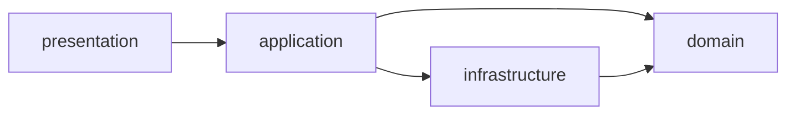
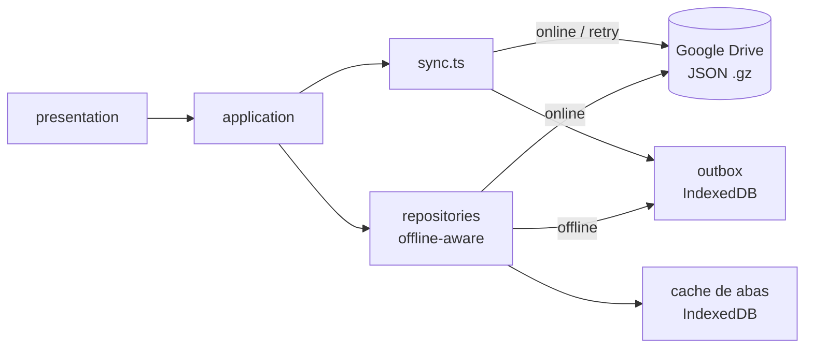

# Arquitetura — SOLID & DDD

Este documento descreve como o projeto aplica os princípios **SOLID** e as
técnicas de **Domain-Driven Design** em uma arquitetura em camadas (Clean
Architecture / Ports & Adapters), mantendo os requisitos funcionais e não
funcionais da especificação (RF01–RF23, RNF02–RNF08).

## Camadas

```
src/
├── domain/            # Núcleo: entidades, objetos de valor, serviços de domínio e ports
├── application/       # Casos de uso (orquestração), sem UI nem detalhes de infra
├── infrastructure/    # Adaptadores: Google Drive/Identity, criptografia, cotações, storage, cache
│   ├── cripto/        # Web Crypto (PBKDF2/AES-GCM), envelope, chaves em memória, cofre local
│   ├── driveFile/     # Cofre JSON do Drive (container.ts: gzip ⇄ cifra)
│   └── cotacoes/      # Brapi, Mais Retorno e a planilha Google (opcional)
└── presentation/      # UI React: app, features, components, hooks
```

A regra de dependência é unidirecional:



- **`domain`** não conhece React, `fetch`, `localStorage` ou `Date.now()` direto —
  é 100% testável e determinístico.
- **`application`** orquestra casos de uso (ex.: `carregarDashboard`,
  `syncConsolidado`) usando o domínio e os repositórios.
- **`infrastructure`** implementa os contratos definidos no domínio (ports) e as
  integrações externas.
- **`presentation`** consome apenas casos de uso e módulos puros do domínio.

> As pastas antigas (`src/lib`, `src/services`, `src/types`, `src/features`,
> `src/components`, `src/hooks`, `src/app`) foram preservadas como **re-exports
> (shims)** para os novos caminhos, para não quebrar imports existentes.
> O código real vive nas camadas acima.

## Mapa do domínio

| Artefato DDD | Onde vive |
| --- | --- |
| **Entidades** (com identidade) | `domain/entities.ts` — `Operacao`, `Provento`, `Consolidado`, `Snapshot`, `MetaRebalanceamento`, `Ativo` |
| **Objetos de valor / convenções** | `domain/money.ts` (centavos), `domain/dates.ts` (ISO `YYYY-MM-DD`), `domain/categoria.ts` (enum canônico) |
| **Serviços de domínio** (lógica pura) | `domain/consolidado.ts`, `domain/dashboard.ts`, `domain/detalheAtivo.ts`, `domain/cotacoes.ts`, `domain/eventosCorporativos.ts`, `domain/b3Import.ts`, `domain/rebalanceamento/*` |
| **Formato do envelope cifrado** | `domain/criptografia.ts` — magic `MINHASACOES-ENC1`, cabeçalho em claro (`v`, `kdf`, `cifra`), Base64 e validação da senha (sem Web Crypto) |
| **Ports (contratos de repositório)** | `domain/repositories/ports.ts` — `Repository<T>`, `CrudRepository<T>` |
| **Linguagem ubíqua** | `Operacao`, `Provento`, `Consolidado`, `Snapshot`, `Carteira`, `Aporte`, `Desvio`, `Split`, `Grupamento`, `Bonificação` |

## Camada anticorrupção (dados em células)

`infrastructure/sheets/*` e `infrastructure/driveFile/*` traduzem entre o
domínio e a origem de dados, para que a "língua" das células (intervalos A1,
cabeçalhos, valores tipados) nunca vaze para o domínio:

- `sheetsSchema.ts` (domínio) — nomes e cabeçalhos das abas do schema (fonte única).
- `sheetCodecs.ts` — conversão linha ↔ entidade.
- `sheetCells.ts` — células ↔ valores tipados (datas serial, centavos, pt-BR).
- `sheetFormulas.ts` — fórmulas `GOOGLEFINANCE`/soma da aba `Consolidado`
  (legado Sheets; com o banco JSON o `Consolidado` é 100% calculado no cliente).
- `sheets/gateway.ts` — porta de rede legada da API do Google Sheets (usada com
  `VITE_GOOGLE_BACKEND=sheets`).
- `driveFile/gateway.ts` — porta de rede do banco JSON no Drive: mesma
  superfície de células, sobre um arquivo `minhasacoes.json.gz` compactado com
  gzip e lido/escrito via `drive.file`.
- `driveFile/format.ts` — codec do arquivo (`{ version, sheets }` com uma matriz
  `CellValue[][]` por aba) + normalização idempotente de abas/cabeçalhos.
- `driveFile/container.ts` — única ponte entre o codec puro (`format.ts`) e o
  envelope (`cripto/envelope.ts`): comprime **antes** de cifrar, decide o estado
  pelo magic e lança `ChaveNecessariaError` quando falta a chave.
- `sheets/localSheets.ts` — a mesma superfície de células sobre o IndexedDB, com
  cifra **por aba** (ver "Modo local").
- `driveFile/api.ts` — primitivas HTTP do arquivo (criar/ler/escrever/listar),
  com timeout obrigatório e controle de concorrência por `etag` + `If-Match`.
- `sheets/gatewayRouter.ts` — único ponto de decisão da origem: modo `local` ou
  `google` e, no modo Google, o backend de build (`sheets` ↔ `json`).

## Princípios SOLID

| Princípio | Aplicação |
| --- | --- |
| **S** — Responsabilidade única | Cada módulo tem uma razão para mudar: `domain/consolidado.ts` calcula; `application/consolidado.ts` sincroniza; `infrastructure/driveFile/gateway.ts` fala HTTP/Drive. |
| **O** — Aberto/fechado | Novas fontes de cotação ou novos tipos de evento são adicionados sem alterar os módulos consumidores (ex.: `resolverCotacao` por categoria). |
| **L** — Substituição de Liskov | `CrudRepository<T>` estende `Repository<T>` sem quebrar os contratos; qualquer implementação de um port pode substituir a atual. |
| **I** — Segregação de interfaces | `Repository<T>` (leitura+escrita de aba) é separado de `CrudRepository<T>` (edição/remoção por ID). |
| **D** — Inversão de dependência | O domínio define `Repository<T>`/`RepositoryContext` em `domain/repositories/ports.ts`; a infraestrutura os implementa (`infrastructure/repositories.ts`). |

## Casos de uso (application)

- `application/dashboard.ts` — carregar dashboard (cache-first, RF07–RF11).
- `application/consolidado.ts` — sincronizar a aba `Consolidado` (Seção 5.1).
- `application/historico.ts` — snapshot patrimonial idempotente (RF18).
- `application/rebalanceamento.ts` — metas/aporte/desvios (RF12–RF17).
- `application/b3Import.ts` — importar extrato B3 com deduplicação (RF23).
- `application/diagnostics.ts` — diagnóstico da camada de dados **somente
  leitura** (um `batchGet` + releitura do cache, sem gravar linhas de teste); o
  relatório inclui o estado do ambiente (criptografia verificada + planilha de
  cotações), lido por `lerDiagnosticoAmbiente` sem escrever nada.
- `application/criptografia.ts` — ativar/desativar a cifra, "Bloquear agora" e
  `estadoDoBanco` (estado real do arquivo/abas). Concentra as pré-condições e as
  mensagens exibidas pela UI: Web Crypto disponível, backend capaz de cifrar,
  online e fila vazia (no modo local, offline vale).
- `application/planilhaCotacoes.ts` — estado da planilha de cotações e a
  autorização **explícita** do escopo incremental; nenhum caminho lança.
- `application/migrarPlanilha.ts` — migração do banco antigo (Sheets) para o
  cofre JSON: lê a planilha, cria o cofre, grava as abas e aponta o workspace;
  idempotente e **nunca** altera a planilha antiga.
- `application/sync.ts` — sincronização da fila offline (FIFO), recálculo do
  `Consolidado` ao final do flush e `contarPendencias()` para a UX. O flush
  inteiro roda em `executarEmLote` (no backend JSON: 1 download + 1 upload) e a
  fila só é limpa depois que o lote é gravado.

## Adaptadores (infrastructure)

- `driveFile/*` — banco JSON no Google Drive via `drive.file` (RF01–RF06):
  operações de células sobre um único arquivo compactado, cache do banco
  decodificado por sessão e flush em lote. Com criptografia ativa o arquivo
  passa a ser `magic + cabeçalho em claro + ciphertext` (ver "Criptografia e
  privacidade").
- `cripto/*` — primitivas e envelope com Web Crypto:
  `webCrypto.ts` (PBKDF2-SHA256 + AES-256-GCM nativos), `envelope.ts`
  (cifrar/decifrar o arquivo), `chaveSessao.ts` (chaves **só em memória**),
  `verificadorLocal.ts` (desbloqueio offline) e `localCofre.ts` (cofre do banco
  local).
- `cotacoes/planilhaGoogle/*` — planilha separada que executa o
  `GOOGLEFINANCE` e serve de fonte primária de preços de B3 (ver "Planilha de
  cotações (opcional)").
- `drive.ts`, `googleIdentity.ts`, `googleConfig.ts` — OAuth 2.0 e organização
  no Drive. `drive.ts` garante a pasta padrão `databases_app_minhas_acoes`
  (`ensureAppFolder`) e move para ela o arquivo criado (`moveFileToFolder`) —
  tudo coberto pelo escopo `drive.file`, sem permissões extras.
- `compression.ts` — compactação gzip nativa (`CompressionStream`) do banco JSON.
- `cotacoes/` — integrações de cotação (cache-first, nunca lançam). As portas
  ficam em `domain/provedoresCotacao.ts` (`ProvedorCotacoesB3`,
  `ProvedorCotacoesCripto`, `ProvedorCotacoesTesouro`, `ProvedorListaTickers`,
  `IntegracaoCotacao`). Cada API é um adaptador em `cotacoes/<provedor>/`
  (`brapi/` e `maisRetorno/`), e `cotacoes/registro.ts` monta a cadeia de
  fallback em ordem de prioridade.
  **Para adicionar uma API:** implemente um `IntegracaoCotacao` com as
  capacidades que ela suporta e inclua-o em `integracoesCotacao`. O token
  (`<id>_token` na aba `Configuracoes`) e o card em Configurações aparecem
  automaticamente. A UI acessa tudo via `application/integracoesCotacao.ts`.
  `OpcoesConsultaCotacoes` aceita ainda `aoConsultar` (avisa cada item
  consultado) e `signal` (cancelamento) — usados pela modal de progresso do
  botão **Atualizar** (`ProgressoModal` + `useDashboard.atualizarComProgresso`).
  Cada integração pode expor `teste` (`ProvedorTesteConexao`): o diagnóstico
  faz uma chamada ao ticker de referência e lê a cota pelos headers
  `RateLimit-*` (`cotacoes/quota.ts`), sem depender do nome de cada API.
- `storage.ts` — `localStorage` para token/workspace/consent (RNF05).
- `db.ts` + `kvStore.ts` — IndexedDB (stores `sheets`/`outbox`) com espelho em
  memória para leitura síncrona e migração única do `localStorage`.
- `cache.ts` — cache das abas (IndexedDB) (RNF02/RNF08).
- `outbox.ts` — fila persistente de mutações offline.
- `offlineRepositories.ts` — decorador que roteia escritas para o outbox quando
  offline (atualização otimista no cache).
- `repositories.ts` — repositórios por aba (envoltos) + repositórios crus para
  o replay da sincronização.

## PWA & Offline-first

O app é um **PWA instalável** com funcionamento **offline**. O service worker
(`vite-plugin-pwa`) cuida do **app shell** (assets estáticos); os **dados**
continuam sendo cacheados pela própria aplicação — nunca pelo SW, pois as
requisições ao Google carregam `Bearer token`.



- **Leitura offline**: cache-first — `repositories.ts` lê do cache e só busca a
  API em cache frio/`forceRefresh`; `application/dashboard.ts` monta o dashboard
  inteiro do cache (`lerDashboardDoCache`).
- **Escrita offline**: `offlineRepositories.ts` aplica a mutação de forma
  otimista no cache e a enfileira no outbox; a aba derivada `Consolidado`
  **nunca** enfileira.
- **Sincronização**: `application/sync.ts` reaplica a fila em ordem FIFO com
  idempotência por ID, renova o token em 401, interrompe em falha de rede/quota
  (mantendo o item) e, ao final, recalcula o `Consolidado` **uma vez** e
  refresca o cache. É disparada por `useSync` (mount, reconexão, retry 60s).
- **Auth offline**: o `AuthProvider` não desloga por falta de rede e renova o
  token ao reconectar.
- **UX**: `useSyncStatus` + `SyncStatusBadge` mostram online/offline, pendências
  e um botão "Sincronizar agora".
- **Persistência**: `db.ts`/`kvStore.ts` usam IndexedDB com espelho em memória
  para manter a API síncrona exigida pelos contratos de domínio; migração única
  do formato antigo em `localStorage`.

## Criptografia e privacidade

O banco inteiro (não células isoladas) pode ser cifrado no backend `json` e no
modo local. O formato é o de `PLANO_CRIPTOGRAFIA.md` §3.2:

```
0        17 bytes: magic ASCII "MINHASACOES-ENC1" + "\n"
17       cabeçalho JSON em claro + "\n"
...      ciphertext (AES-256-GCM de gzip(JSON))
```

- **Primitivas**: AES-256-GCM (autenticada: chave errada e adulteração falham na
  tag) com chave derivada por **PBKDF2-HMAC-SHA256, 600.000 iterações** e salt
  de 16 bytes; IV de 12 bytes novo a cada gravação.
- **AAD**: os bytes do cabeçalho em claro vão como dado autenticado — trocar
  salt, iterações ou IV invalida a tag, então o estado "arquivo cifrado" não pode
  ser forjado. O cabeçalho fica em claro de propósito: é o que permite detectar
  o estado **sem** a chave.
- **Detecção**: só pelo magic do arquivo (nunca por "não é gzip"); o mesmo
  `DATABASE_FILE_VERSION` e o mesmo nome/MIME continuam valendo.
- **Chave só em memória**: `cripto/chaveSessao.ts` guarda um
  `Map<spreadsheetId, SessaoCripto>`; nada em `localStorage`, `sessionStorage`
  ou IndexedDB. Reload, logout, troca de banco e "Bloquear agora" pedem a senha
  de novo.
- **Desbloqueio offline**: `cripto/verificadorLocal.ts` grava, no primeiro
  desbloqueio, um bloco fixo cifrado + parâmetros do KDF
  (`cripto-verificador::<spreadsheetId>`). Sem rede o app deriva a chave de novo
  e valida a tag; a senha e a chave **nunca** são gravadas. O registro é apagado
  ao desativar a cifra ou esquecer o banco.
- **O que a criptografia não protege**: o cache de abas e o outbox no IndexedDB
  ficam em claro (mitigado por "Bloquear agora" e logout), o `.ods` exportado é
  texto puro, os metadados do arquivo (nome, tamanho, datas) e a lista de
  tickers da planilha de cotações são visíveis, e **não há recuperação**: senha
  esquecida = dados perdidos.
- O backend **`sheets` não cifra** — as células precisam ficar legíveis para as
  fórmulas (`GOOGLEFINANCE`, `Consolidado`).

## Modo local

- `sheets/localSheets.ts` é **assíncrono** (mesma superfície do gateway, agora
  aguardando a decifra) e cifra **cada aba** com AES-256-GCM e AAD = bytes da
  própria chave do registro (`local-sheet::<aba>`): copiar o envelope de uma aba
  para outra invalida a tag.
- `cripto/localCofre.ts` é o cofre do banco local (id sintético `local`), no
  mesmo formato do verificador de desbloqueio offline; a chave continua só em
  `chaveSessao`.
- `sheets/localGateway.ts` propaga `ChaveNecessariaError` quando o cofre existe e
  a sessão está bloqueada.
- Exportar/importar `.ods` continua em claro, igual ao backend `json`.

## Planilha de cotações (opcional)

- `cotacoes/planilhaGoogle/*` é um `IntegracaoCotacao` que grava as fórmulas
  `GOOGLEFINANCE` uma vez por ticker e lê os preços em lote. Nada da carteira
  mora nela: se for apagada, é recriada.
- Nome fixo `Minhas Ações — Cotações` (aba `Cotações`), criada na pasta
  `databases_app_minhas_acoes` como o cofre. A Sheets API não aceita `parents`, então a
  planilha nasce na raiz e é movida logo depois (`garantirNaPasta`); se a pasta
  falhar, ela segue válida na raiz.
- Criação é preguiçosa: acontece na primeira consulta de cotações depois da
  autorização (antes disso, id salvo → descoberta por nome → criação).
- A cadeia de preços é **Planilha → Brapi → Mais Retorno**
  (`cotacoes/registro.ts`); a planilha só entra depois da autorização
  incremental do escopo `spreadsheets`, pedida em Configurações.
- Estados expostos por `application/planilhaCotacoes.ts`: **`ativa`**,
  **`nao-autorizada`** e **`indisponivel`** (com motivo) — mostrados no card e no
  Diagnóstico.
- Regra: a integração **nunca lança**. Sem escopo, 403, planilha apagada ou
  rede fora, devolve resultado vazio e a cadeia segue pelas APIs — o dashboard
  não muda.

## Convenções

- Dinheiro sempre em **centavos inteiros** (`number`), convertido na borda.
- Datas internas em ISO `YYYY-MM-DD`; exibição `DD/MM/AAAA`.
- Categoria sempre pelo enum canônico `CategoriaAtivo`.
- Nenhuma lógica de negócio em componentes React — tudo vive em `domain`/`application`.
- Persistência local: dados (cache/outbox) no **IndexedDB**; credenciais
  (token/workspace/consent) no **localStorage**.
