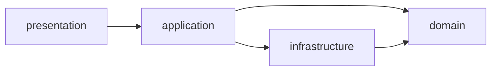

# Arquitetura — SOLID & DDD

Este documento descreve como o projeto aplica os princípios **SOLID** e as
técnicas de **Domain-Driven Design** em uma arquitetura em camadas (Clean
Architecture / Ports & Adapters), mantendo os requisitos funcionais e não
funcionais da especificação (RF01–RF23, RNF02–RNF08).

## Camadas

```
src/
├── domain/            # Núcleo: entidades, objetos de valor, serviços de domínio e ports
├── application/       # Casos de uso (orquestração), sem UI nem detalhes de infra
├── infrastructure/    # Adaptadores: Google Sheets/Drive/Identity, storage, cache, Tesouro
└── presentation/      # UI React: app, features, components, hooks
```

A regra de dependência é unidirecional:



- **`domain`** não conhece React, `fetch`, `localStorage` ou `Date.now()` direto —
  é 100% testável e determinístico.
- **`application`** orquestra casos de uso (ex.: `carregarDashboard`,
  `syncConsolidado`) usando o domínio e os repositórios.
- **`infrastructure`** implementa os contratos definidos no domínio (ports) e as
  integrações externas.
- **`presentation`** consome apenas casos de uso e módulos puros do domínio.

> As pastas antigas (`src/lib`, `src/services`, `src/types`, `src/features`,
> `src/components`, `src/hooks`, `src/app`) foram preservadas como **re-exports
> (shims)** para os novos caminhos, para não quebrar imports existentes.
> O código real vive nas camadas acima.

## Mapa do domínio

| Artefato DDD | Onde vive |
| --- | --- |
| **Entidades** (com identidade) | `domain/entities.ts` — `Operacao`, `Provento`, `Consolidado`, `Snapshot`, `MetaRebalanceamento` |
| **Objetos de valor / convenções** | `domain/money.ts` (centavos), `domain/dates.ts` (ISO `YYYY-MM-DD`), `domain/categoria.ts` (enum canônico) |
| **Serviços de domínio** (lógica pura) | `domain/consolidado.ts`, `domain/dashboard.ts`, `domain/detalheAtivo.ts`, `domain/cotacoes.ts`, `domain/eventosCorporativos.ts`, `domain/b3Import.ts`, `domain/rebalanceamento/*` |
| **Ports (contratos de repositório)** | `domain/repositories/ports.ts` — `Repository<T>`, `CrudRepository<T>` |
| **Linguagem ubíqua** | `Operacao`, `Provento`, `Consolidado`, `Snapshot`, `Carteira`, `Aporte`, `Desvio`, `Split`, `Grupamento`, `Bonificação` |

## Camada anticorrupção (Sheets)

`infrastructure/sheets/*` traduz entre o domínio e a planilha do Google, para
que a "língua" do Sheets (células, cabeçalhos, fórmulas) nunca vaze para o
domínio:

- `sheetsSchema.ts` (domínio) — nomes e cabeçalhos das 5 abas (fonte única).
- `sheetCodecs.ts` — conversão linha ↔ entidade.
- `sheetCells.ts` — células ↔ valores tipados (datas serial, centavos, pt-BR).
- `sheetFormulas.ts` — fórmulas `GOOGLEFINANCE`/soma da aba `Consolidado`.
- `gateway.ts` — porta de rede da API do Google Sheets.

## Princípios SOLID

| Princípio | Aplicação |
| --- | --- |
| **S** — Responsabilidade única | Cada módulo tem uma razão para mudar: `domain/consolidado.ts` calcula; `application/consolidado.ts` sincroniza; `infrastructure/sheets/gateway.ts` fala HTTP. |
| **O** — Aberto/fechado | Novas fontes de cotação ou novos tipos de evento são adicionados sem alterar os módulos consumidores (ex.: `resolverCotacao` por categoria). |
| **L** — Substituição de Liskov | `CrudRepository<T>` estende `Repository<T>` sem quebrar os contratos; qualquer implementação de um port pode substituir a atual. |
| **I** — Segregação de interfaces | `Repository<T>` (leitura+escrita de aba) é separado de `CrudRepository<T>` (edição/remoção por ID). |
| **D** — Inversão de dependência | O domínio define `Repository<T>`/`RepositoryContext` em `domain/repositories/ports.ts`; a infraestrutura os implementa (`infrastructure/repositories.ts`). |

## Casos de uso (application)

- `application/dashboard.ts` — carregar dashboard (cache-first, RF07–RF11).
- `application/consolidado.ts` — sincronizar a aba `Consolidado` (Seção 5.1).
- `application/historico.ts` — snapshot patrimonial idempotente (RF18).
- `application/rebalanceamento.ts` — metas/aporte/desvios (RF12–RF17).
- `application/b3Import.ts` — importar extrato B3 com deduplicação (RF23).
- `application/diagnostics.ts` — diagnóstico da camada de dados.

## Adaptadores (infrastructure)

- `sheets/gateway.ts` — Google Sheets API v4 (RF01–RF06).
- `drive.ts`, `googleIdentity.ts`, `googleConfig.ts` — Google Picker e OAuth.
- `tesouro.ts` — cotações do Tesouro Direto (cache + fallback, RF19).
- `storage.ts`, `cache.ts` — `localStorage` e cache das abas (RNF02/RNF08).
- `repositories.ts` — implementação concreta dos repositórios por aba.

## Convenções

- Dinheiro sempre em **centavos inteiros** (`number`), convertido na borda.
- Datas internas em ISO `YYYY-MM-DD`; exibição `DD/MM/AAAA`.
- Categoria sempre pelo enum canônico `CategoriaAtivo`.
- Nenhuma lógica de negócio em componentes React — tudo vive em `domain`/`application`.
