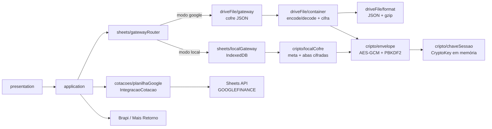
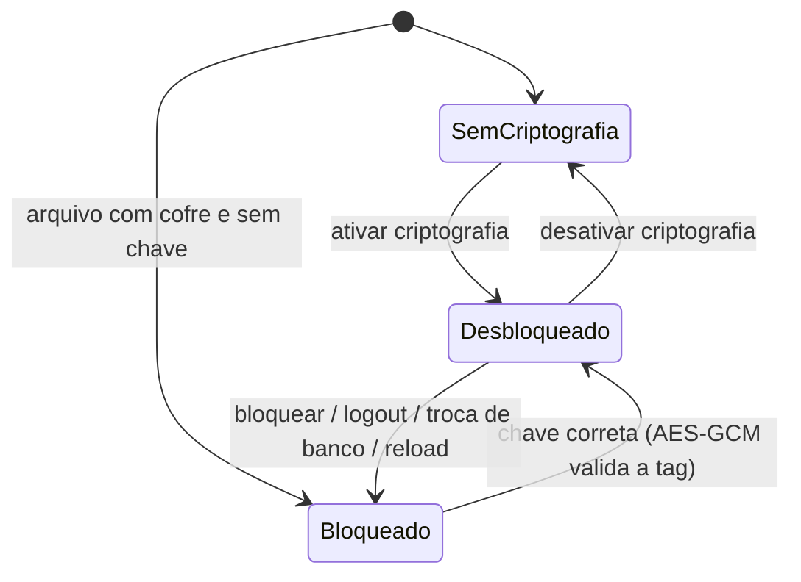

# Plano de implementação — Criptografia do banco + planilha de cotações (opção D)

> Status: **planejado** (nada implementado).
> Este é o plano de execução. O histórico de alternativas avaliadas (opções A,
> B e C, análise do `GOOGLEFINANCE`, etc.) está em
> [`PLANO_CRIPTOGRAFIA_ANALISE.md`](./PLANO_CRIPTOGRAFIA_ANALISE.md).

---

## 1. Resultado esperado

1. **Backend `json` vira o padrão** do app: a carteira é um único arquivo
   `minhasacoes.json.gz` no Google Drive, acessível só com `drive.file`.
2. **Toggle em Configurações** cifra o banco inteiro (arquivo no Drive) e
   também o banco local do navegador. A **chave é pedida ao abrir/criar** e
   **nunca é persistida**.
3. **Cotações** continuam com `GOOGLEFINANCE`, mas em uma **planilha Google
   separada**, usada apenas como serviço. Ela entra na cadeia de integrações como
   uma fonte **opcional**: se o escopo for negado ou a planilha falhar, o app a
   **ignora** e cota pelas APIs (Brapi → Mais Retorno).
4. Bancos antigos em Google Sheets têm **migração automática** para o cofre JSON.

### Fluxo em uma imagem



---

## 2. Decisões aprovadas (02/11/2026)

| # | Decisão |
| --- | --- |
| 1 | Cifrar o **arquivo inteiro** (não células isoladas). |
| 2 | **Sem tamanho mínimo** de senha (apenas não vazia). |
| 3 | **PBKDF2-SHA256 com 600.000 iterações** (opção mais segura). |
| 4 | **"Bloquear agora" limpa o cache de abas** (o outbox é sincronizado antes; se impossível, permanece com aviso). |
| 5 | **Checkbox "Criar banco criptografado"** na criação. |
| 6 | **Modo local entra na v1**, com cofre próprio no IndexedDB. |
| 7 | **Backend `json` vira o padrão** do app. |
| 8 | **Cotações em planilha Google separada**, como integração **opcional**; cadeia **Planilha → Brapi → Mais Retorno**. |
| 9 | Escopo `spreadsheets` pedido **incrementalmente**, só quando o usuário ativa a planilha de cotações. |
| 10 | **Desbloqueio offline** via **verificador local** (sem persistir a chave). |
| 11 | Checkbox **"Entendi que não há recuperação"** na criação e na ativação. |
| 12 | **"Bloquear agora" sempre pede confirmação.** |
| 13 | A tela de bloqueio **mostra o nome do banco**. |

Backend `sheets` continua compilável (build alternativo), mas **sem**
criptografia: as células precisam ficar legíveis para as fórmulas.

---

## 3. Criptografia do cofre

### 3.1 Primitivas (Web Crypto, sem dependências novas)

| Item | Escolha |
| --- | --- |
| Cifra | **AES-256-GCM** (autenticada: detecta adulteração e chave errada) |
| Derivação | **PBKDF2-HMAC-SHA256**, 600.000 iterações, salt de 16 bytes |
| IV | 12 bytes aleatórios **a cada gravação** |
| AAD | bytes do cabeçalho em claro (impede trocar salt/iterações/IV) |
| Chave | `CryptoKey` não-extraível, **somente em memória** (por `spreadsheetId`) |
| Persistência da chave | **nenhuma** (`localStorage`, IndexedDB e `sessionStorage` proibidos) |

Contexto seguro: Web Crypto exige HTTPS ou `localhost`; fora disso o toggle fica
desabilitado (`isCriptografiaSuportada() === false`).

### 3.2 Formato do arquivo

```
0        17 bytes: magic ASCII "MINHASACOES-ENC1" + "\n"
17       cabeçalho JSON (UTF-8) + "\n"
...      ciphertext (AES-256-GCM de gzip(JSON))
```

Cabeçalho (em claro — é o que permite detectar o estado **sem** a chave):

```json
{
  "v": 1,
  "kdf": { "n": "PBKDF2-SHA256", "i": 600000, "s": "<base64 16 bytes>" },
  "cifra": { "n": "AES-256-GCM", "iv": "<base64 12 bytes>" }
}
```

- Detecção: bytes começam com o magic → cifrado; senão é o formato atual
  (`0x1f 0x8b` = gzip ou `{` = fallback). **Nunca** usar "não é gzip".
- `{ version, sheets }` dentro do envelope continua igual
  (`DATABASE_FILE_VERSION` não muda).
- Nome e MIME do arquivo não mudam; a listagem (`name contains '.json.gz'`)
  segue funcionando.
- Comprimir **antes** de cifrar.

### 3.3 Estados da chave



- `Desbloqueado` é **por banco** (`Map<spreadsheetId, CryptoKey>`).
- Reload sempre perde a chave (comportamento desejado).
- No modo local a chave fica sob o id sintético `local`.
- **Desbloqueio offline (decisão 10):** no primeiro desbloqueio bem-sucedido o
  app guarda no IndexedDB um **verificador** por banco
  (`cripto-verificador::<spreadsheetId>`):
  `{ versao, kdf: { iteracoes, salt }, iv, verificador }`, onde `verificador` é
  um bloco fixo cifrado com a chave. Sem internet, o app deriva a chave com
  esses parâmetros e tenta decifrar o verificador — se abrir, a senha está
  correta e o app carrega do cache. **A senha e a chave nunca são gravadas.**
  O verificador é apagado ao desativar a criptografia ou ao "Esquecer este
  banco".

### 3.4 O que a criptografia não protege (mostrar na UI)

- Cache de abas e outbox continuam em claro no IndexedDB (mitigado por
  "Bloquear agora" e logout).
- `.ods` exportado é texto puro.
- Metadados do arquivo (nome, tamanho, datas) e a **lista de tickers** da
  planilha de cotações são visíveis.
- Não há recuperação de chave: senha esquecida = dados perdidos.

---

## 4. Planilha de cotações (integração opcional)

### 4.1 Desenho

- Planilha Google separada, criada **pelo próprio app** (escopo incremental),
  com apenas: `Ticker`, `Preço Atual`, `Preço Abertura`, `Variação Dia (%)`.
- As fórmulas são escritas com `USER_ENTERED`:
  `=GOOGLEFINANCE("BVMF:"&$A2;"price")` e `...("priceopen")`; a variação usa
  `buildVariacaoDiaFormula`. Reutiliza `buildGoogFinanceFormula` /
  `buildGoogFinanceOpenFormula` de `sheetFormulas.ts`.
- O app reconcilia os tickers das posições abertas e lê os preços em **um**
  `values.get` por sincronização.
- É **derivada e descartável**: se for apagada, o app recria; nenhum dado da
  carteira vive nela.

### 4.2 Estados e degradação

| Estado | Detecção | Comportamento |
| --- | --- | --- |
| `ativa` | token tem `spreadsheets` e a planilha responde | fonte **primária** de B3 |
| `não autorizada` | `scope` do token **não** inclui `spreadsheets` (checagem local) | não chama a API; cota por Brapi → Mais Retorno |
| `indisponível` | `403 ACCESS_TOKEN_SCOPE_INSUFFICIENT` / `PERMISSION_DENIED`, planilha apagada, erro de rede | ignora; memoriza o estado na sessão para não repetir chamadas |

Regras obrigatórias (contrato da porta `IntegracaoCotacao`: **nunca lançar**):

- sem escopo → devolve todos os tickers em `semCotacao`, sem rede;
- qualquer falha → `semCotacao` + estado memorizado;
- o app **não insiste** pedindo autorização; só por ação explícita no card de
  Configurações;
- o dashboard não mostra erro por causa da planilha.

### 4.3 Autorização incremental

- Escopo base: `drive.file` (`GOOGLE_SCOPES`).
- `SHEETS_SCOPE = 'https://www.googleapis.com/auth/spreadsheets'`.
- Ao ativar a planilha em Configurações: `requestAccessToken` com
  `[...GOOGLE_SCOPES, SHEETS_SCOPE]`; se o usuário cancelar
  (`isUserCancellation`), estado `não autorizada` e nada quebra.
- O token salvo guarda `scope` (`StoredToken`); a checagem é local e barata.
- Em produção o escopo é **sensível** e exige verificação OAuth (processo já em
  andamento); enquanto não verificada, o Google mostra o aviso de app não
  verificado e aplica limite de usuários.

### 4.4 Ordem na cadeia

`Planilha → Brapi → Mais Retorno` (decidido). Consequências:

- 1 leitura em lote por sync; só o que faltar segue para as APIs.
- Um ticker recém-incluído pode voltar vazio no primeiro ciclo
  (`GOOGLEFINANCE` é assíncrono) → `semCotacao` → API assume → próximo sync já
  tem valor.
- `aoConsultar` reporta `planilha <ticker>` na barra de progresso.
- `lerCache`/`limparCache` no mesmo padrão de `brapi/cotacoesB3.ts` (IndexedDB).

---

## 5. Mudanças por arquivo

### 5.1 Domínio

| Arquivo | Mudança |
| --- | --- |
| `domain/criptografia.ts` (**novo**) | magic, versão, `validarChave` (só rejeita vazia), parsing/montagem do cabeçalho, base64 |
| `domain/workspace.ts` | `SpreadsheetWorkspace.criptografia?: 'nenhuma' \| 'total'` (opcional; antigos = `'nenhuma'`) |
| `domain/provedoresCotacao.ts` | `OpcoesConsultaCotacoes.accessToken?: string` (token OAuth para a planilha) |

### 5.2 Infraestrutura — criptografia

| Arquivo | Mudança |
| --- | --- |
| `infrastructure/cripto/webCrypto.ts` (**novo**) | `isCriptografiaSuportada`, `derivarChave`, `cifrarBytes`, `decifrarBytes` |
| `infrastructure/cripto/envelope.ts` (**novo**) | container (magic + cabeçalho + ciphertext), `estaCifrado`, `cifrarArquivo`, `decifrarArquivo`, `abrirComSenha`, `ChaveIncorretaError` |
| `infrastructure/cripto/chaveSessao.ts` (**novo**) | `temChave`, `guardarChave`, `obterChave`, `esquecerChave`, `esquecerTodasAsChaves` |
| `infrastructure/cripto/localCofre.ts` (**novo**) | meta do cofre local (`kdf` + `verificador`), `criarCofreLocal`, `abrirCofreLocal` |
| `infrastructure/cripto/verificadorLocal.ts` (**novo**) | verificador por banco no IndexedDB para **desbloqueio offline** (decisão 10) |

### 5.3 Infraestrutura — cofre (Drive e local)

| Arquivo | Mudança |
| --- | --- |
| `driveFile/container.ts` (**novo**) | `codificarBanco(sheets, version, chave)` / `decodificarBanco(bytes, chave)` — mantém `format.ts` puro |
| `driveFile/gateway.ts` | `Entry.criptografado`; `fetchEntry` decifra (ou lança `ChaveNecessariaError` 423); `uploadDatabase` recifra; `resolveConflict` decifra/recifra; `createDefaultSpreadsheet(opcoes.chave)`; `alterarCriptografia`; `estadoCriptografia`; `loadSpreadsheetWorkspace` propaga `criptografia` |
| `sheets/gatewayRouter.ts` | repasses (`criarWorkspace`, `alterarCriptografia`, `estadoCriptografia`), `criptografiaDisponivel()` = `(isJsonBackend() \|\| isModoLocal()) && isCriptografiaSuportada()` |
| `sheets/localSheets.ts` | API vira **assíncrona**; cada matriz gravada como envelope cifrado quando o cofre local está ativo |
| `sheets/localGateway.ts` | `await` em todas as leituras/escritas (inclui `localLoadWorkspace`) + `ChaveNecessariaError` quando há cofre sem chave |

### 5.4 Infraestrutura — cotações

| Arquivo | Mudança |
| --- | --- |
| `cotacoes/planilhaGoogle/api.ts` (**novo**) | criar/descobrir planilha, `values.get`, `values.update` (`USER_ENTERED`), `batchUpdate` |
| `cotacoes/planilhaGoogle/planilha.ts` (**novo**) | `garantirPlanilha`, `reconciliarTickers`, `lerCotacoes` (parse tolerante a `#N/A`, vazio e preço < R$ 0,20) |
| `cotacoes/planilhaGoogle/index.ts` (**novo**) | `integracaoPlanilhaGoogle: IntegracaoCotacao` (`b3`, `exigeToken: false`) + estado (`ativa` / `não autorizada` / `indisponível`) + cache |
| `cotacoes/registro.ts` | registrar **antes** de Brapi: `[integracaoPlanilhaGoogle, integracaoBrapi, integracaoMaisRetorno]` |
| `googleConfig.ts` | `GOOGLE_BACKEND` padrão = `json`; exportar `SHEETS_SCOPE` |
| `.env.example` / `README.md` | refletir `json` como padrão e o escopo incremental |

### 5.5 Aplicação

| Arquivo | Mudança |
| --- | --- |
| `application/criptografia.ts` (**novo**) | `ativarCriptografia`, `desativarCriptografia`, `bloquearBanco`, `estadoDoBanco` (Google exige online/fila vazia; local funciona offline) |
| `application/migrarPlanilha.ts` (**novo**) | ler abas via `sheets/gateway` (Sheets API) → criar cofre JSON → gravar abas → apontar workspace → invalidar cache; idempotente |
| `application/dashboard.ts` | informar `accessToken` nas consultas de cotação; usar os preços da planilha quando `ativa` |
| `application/sync.ts` | não executar flush quando o banco está cifrado e bloqueado |
| `application/diagnostics.ts` | expor `criptografia` e estado da planilha de cotações |
| `application/integracoesCotacao.ts` | incluir a planilha em `limparCachesCotacao` |

### 5.6 Apresentação

| Arquivo | Mudança |
| --- | --- |
| `components/Switch.tsx` (**novo**) | toggle acessível (`role="switch"`, teclado) |
| `components/CampoSenha.tsx` (**novo**) | input de senha reutilizável: olho, erro, autofocus, `Enter` envia |
| `components/ModalSenha.tsx` (**novo**) | casca de modal de senha (título, aviso, ações) |
| `components/BadgeProtegido.tsx` (**novo**) | indicador `🔒 Protegido` no header, com ação "Bloquear" |
| `features/configuracoes/ConfiguracoesPage.tsx` | card **"Segurança do banco"**: estado, toggle, modais de ativação/desativação, "Bloquear agora", aviso do `.ods`; card **"Planilha de cotações"** com estados e botão **Autorizar** |
| `features/auth/WorkspaceSetup.tsx` | checkbox **"Criar banco criptografado"** (senha + confirmação), preservado no fluxo de nome duplicado |
| `features/auth/AbrirBancoModal.tsx` | tratar `chave-necessaria` abrindo o modal de senha |
| `features/auth/DesbloquearBanco.tsx` (**novo**) | tela de bloqueio (senha, spinner do PBKDF2, "Esquecer este banco", "Usar sem Google") |
| `app/routes/RouteGuards.tsx` | `status === 'bloqueado'` renderiza a tela de bloqueio |
| `app/providers/AuthProvider.tsx` + `authContext.ts` | `AuthStatus` ganha `'bloqueado'`; `desbloquearBanco`, `bloquearBanco`; `abrirBancoPorId` devolve resultado discriminado; bootstrap bloqueia antes de ler dados; logout/troca esquecem chaves; `criarBanco(title, { chave })` |
| `hooks/useSync.ts` + `components/SyncStatusBadge.tsx` | não sincronizar bloqueado; flush ao desbloquear |
| `features/diagnostico/DiagnosticoPage.tsx` | linha de criptografia/planilha + "Bloquear agora" |
| `features/auth/MigrarPlanilha.tsx` (**novo**) | oferta de migração automática na primeira abertura pós-upgrade |

---

## 6. Fluxos de UX

### 6.1 Abrir banco cifrado

1. Usuário escolhe o banco → `abrirBancoPorId(id)`.
2. Gateway detecta o magic → sem chave → `ChaveNecessariaError` (423).
3. UI pede a senha (modal/tela de bloqueio).
4. Chave correta → `guardarChave` → reabre → dashboard.
5. Chave errada → mensagem + atraso progressivo (0s/1s/2s/5s); nada é alterado.

### 6.2 Ativar criptografia

1. Configurações → "Segurança do banco" → toggle.
2. Modal: senha + confirmação + aviso irreversível + sugestão de backup `.ods`.
3. Google: exige online e fila vazia. Local: funciona offline.
4. Regrava o arquivo (ou as abas locais) → estado "Arquivo criptografado".

### 6.3 Criar banco criptografado

1. `WorkspaceSetup` → marcar o checkbox.
2. Senha + confirmação → `criarBanco(title, { chave })`.
3. O arquivo nasce cifrado e a sessão já fica desbloqueada; reload pede a chave.

### 6.4 Recarregar / bloquear

- `workspace.criptografia === 'total'` e sem chave → tela de bloqueio **antes**
  de qualquer leitura (Drive e local).
- "Bloquear agora": sincroniza o outbox (se possível), **limpa o cache de abas**,
  esquece a chave, estado `bloqueado`; pendências offline permanecem com aviso.

### 6.5 Planilha de cotações

1. Configurações → card → **Autorizar planilha de cotações** → consentimento
   incremental.
2. Autorizado → cria/descobre a planilha, grava o cabeçalho e os tickers.
3. Negado → `não autorizada` (não insiste); cotações seguem pelas APIs.
4. Erro/403 → `indisponível`; idem.

### 6.6 Migração dos bancos antigos

1. Primeira abertura após o upgrade com workspace `sheets` → oferta
   **"Migrar minha planilha para o novo formato"**.
2. Lê as abas, cria o cofre (cifrado se o usuário marcar), grava, aponta o
   workspace e invalida o cache.
3. Sem autorização do escopo → oferece o caminho manual (`.ods`).
4. **Nunca apaga** a planilha antiga.

### 6.7 Mensagens

| Situação | Mensagem |
| --- | --- |
| chave ausente | "Este banco está criptografado. Informe a chave para continuar." |
| chave errada | "Chave incorreta. Verifique e tente novamente." |
| senha vazia | "Informe uma senha (não há mínimo de tamanho, mas não pode ficar em branco)." |
| offline ao ativar (Google) | "Conecte-se à internet para alterar a criptografia." |
| fila pendente (Google) | "Sincronize as alterações pendentes antes de alterar a criptografia." |
| bloqueio com pendências | "Criptografia bloqueada. Há N alterações pendentes que serão enviadas após o desbloqueio." |
| backend `sheets` | "Disponível no cofre JSON e no modo local; no Google Sheets as células precisam ficar legíveis." |
| planilha negada | "Planilha de cotações não autorizada. As cotações usam as APIs." |
| Web Crypto indisponível | "Seu navegador não suporta criptografia neste contexto (é necessário HTTPS)." |
| exportação `.ods` | "O arquivo .ods é exportado sem criptografia." |

### 6.8 UI da chave (telas, componentes e microcopy)

**Regra:** a chave só é pedida em **três superfícies**, conforme o contexto.

| Superfície | Quando | Por quê |
| --- | --- | --- |
| **Tela de bloqueio** (página) | reload, boot, segunda aba, troca de banco | não há dados na tela; garante que o cache não apareça antes da chave |
| **Modal de senha** | abrir banco pela lista, ativar/desativar, bloquear | o usuário já está num fluxo; mantém contexto |
| **Campos inline** | criar banco com o checkbox | é o próprio formulário de criação |

**Matriz de momentos**

| Momento | Superfície | Campos | Ações |
| --- | --- | --- | --- |
| Boot/reload com banco cifrado | `DesbloquearBanco` (guard) | senha | Desbloquear · Esquecer banco · Usar sem Google |
| Escolher banco cifrado na lista | 2º passo do `AbrirBancoModal` (`passo: 'lista' \| 'senha'`) | senha | Voltar · Desbloquear |
| Criar com checkbox | inline no `WorkspaceSetup` | senha + confirmação + "entendi" | Criar banco criptografado |
| Ativar criptografia | `ModalSenha` "Criptografar banco" | senha + confirmação + "entendi" + backup `.ods` | Cancelar · Criptografar |
| Desativar | `ModalSenha` | senha (se não estiver em memória) | Cancelar · Desativar |
| "Bloquear agora" | `ModalSenha` (confirmação) | — | Cancelar · Bloquear |
| Login Google | — | — | a chave **não** é pedida aqui |

**Tela de bloqueio**

```
🔒 Banco protegido
   Minhas Ações — Carteira            <-- nome do banco (decisão 13)

   Senha
   [••••••••••••••••••••]  👁
   ⚠ Chave incorreta. Tente novamente.

   [ Desbloquear ]  (spinner durante PBKDF2)

   Sua senha não é armazenada. Sem ela, os dados não
   podem ser recuperados.

   Esquecer este banco neste dispositivo
   Usar sem Google   (apenas no modo Google)
```

**Abrir banco — 2º passo (mesmo modal)**

```
← Voltar para a lista
🔒 Minhas Ações — Carteira
   Este banco está protegido.

   Senha [••••••••] 👁
   [Cancelar]        [Desbloquear]
```

**Criar banco (inline)**

```
Nome do novo banco de dados
[ Minhas Ações — Carteira                    ]

☑ Criar banco criptografado
   Senha      [••••••••••] 👁
   Confirmar  [••••••••••] 👁
   ⚠ Sem a senha, os dados são irrecuperáveis.
   ☑ Entendi que não há recuperação   <-- obrigatório (decisão 11)

[ Criar banco criptografado ]   [ Abrir banco existente ]
```

**Ativar criptografia (modal)**

```
Isto cifra TODO o conteúdo do banco (operações, proventos,
histórico e tokens de API).
⚠ Sem a senha, os dados são irrecuperáveis.
[ Exportar backup .ods antes ]
Senha     [••••••••] 👁
Confirmar [••••••••] 👁
☑ Entendi que não há recuperação        <-- obrigatório

[Cancelar]                    [Criptografar]
```

**Regras de comportamento**

- "Bloquear agora" **sempre confirma** (decisão 12), avisando sobre pendências.
- **Cancelar** o desbloqueio **não troca** o banco ativo.
- **Deep link** (`/operacoes` direto) → bloqueio → depois de desbloquear, segue
  na rota pedida.
- **Duas abas**: cada aba pede a chave (memória por aba).
- Tentativas: sem bloqueio permanente; atraso progressivo (0s/1s/2s/5s).
- **Acessibilidade**: foco automático, `Enter` envia, erro com `aria-live`,
  rótulo sempre visível, `autoComplete` correto (`current-password` /
  `new-password`), botão de mostrar/ocultar (ícones `Eye`/`EyeOff`).
- **Tema escuro** (`propaganda`): as telas novas precisam dos overrides de cor
  no `index.css`.
- **Desbloqueio offline** (decisão 10): tela idêntica; a validação usa o
  verificador local, sem rede.

**Componentes**

| Componente | Papel |
| --- | --- |
| `CampoSenha` | input + olho + erro + autofocus/Enter (usado em todos os pontos) |
| `DesbloquearBanco` | tela de bloqueio (guard) |
| `ModalSenha` | casca de modal (título, aviso, ações) |
| `SegurancaBancoCard` | card em Configurações (estado + toggle + ações) |
| `BadgeProtegido` | indicador `🔒 Protegido` no header com "Bloquear" |

---

## 7. Fases de implementação

### Fase 0 — Decisões e textos ✅ (02/11/2026)

Decisões 1–9 registradas na seção 2.

### Fase 1 — Validação do escopo (0,5–1 dia, **não bloqueante**)

- [ ] Provar `drive.file` + Sheets API (criar/ler/escrever planilha) e, se
  necessário, `spreadsheets` incremental.
- [ ] Confirmar `GOOGLEFINANCE` retornando número (separador `;` × `,`).
- [ ] Registrar o resultado neste plano.

**Se falhar:** a planilha fica `indisponível` e a entrega segue (APIs).

### Fase 2 — Núcleo criptográfico (1,5 dia)

- [ ] `domain/criptografia.ts`, `cripto/webCrypto.ts`, `cripto/envelope.ts`,
  `cripto/chaveSessao.ts` + testes.

**Aceite:** round-trip; chave errada/adulteração falham; cabeçalho válido.

### Fase 3 — Container e gateway JSON (1,5 dia)

- [ ] `driveFile/container.ts`; mudanças no `driveFile/gateway.ts`;
  `alterarCriptografia`, `estadoCriptografia`, `workspace.criptografia`.
- [ ] Testes de compatibilidade com arquivos em claro e conflito 412.

**Aceite:** banco antigo abre igual; banco cifrado só abre com a chave; 412
resolve cifrado; arquivo no Drive deixa de ser gzip legível.

### Fase 4 — Abertura, bloqueio e sessão (2–2,5 dias)

- [ ] `AuthProvider`/`authContext` (`bloqueado`, resultados, desbloquear,
  bloquear, limpeza de chaves).
- [ ] `RouteGuards`, `DesbloquearBanco` (com o **nome do banco**),
  `AbrirBancoModal` em **2 passos** (lista → senha).
- [ ] `CampoSenha`, `ModalSenha`, `BadgeProtegido`.
- [ ] `cripto/verificadorLocal.ts` + **desbloqueio offline**.
- [ ] Confirmação obrigatória no "Bloquear agora".
- [ ] `useSync`/`SyncStatusBadge` respeitando o bloqueio.

**Aceite:** abrir → senha → dashboard; reload **online e offline** pede a
chave; cancelar não troca o banco ativo; bloqueio confirma antes; logout
esquece chaves; "Bloquear agora" limpa o cache.

### Fase 5 — Configurações e criação (2 dias)

- [ ] `application/criptografia.ts`, `Switch.tsx`, `SegurancaBancoCard`,
  `ModalSenha` (ativar/desativar/bloquear).
- [ ] Checkbox "Criar banco criptografado" no `WorkspaceSetup`, com senha +
  confirmação + **"Entendi que não há recuperação"** (obrigatório).
- [ ] Modal de ativação com o mesmo "Entendi" e o botão de backup `.ods`.

**Aceite:** toggle reflete o estado real; botão de criar/criptografar fica
**desabilitado** sem senha, confirmação igual e "Entendi" marcado; mensagens da
6.7 corretas.

### Fase 6 — Modo local cifrado (2–2,5 dias)

- [ ] `cripto/localCofre.ts`; `localSheets` assíncrono; `localGateway` com
  `await`; revisar chamadores síncronos.
- [ ] Bloqueio/desbloqueio do workspace `local`.

**Aceite:** abas cifradas no IndexedDB (sem texto legível), exporta `.ods` com
aviso, suíte local verde.

### Fase 7 — Planilha de cotações (2–3 dias)

- [ ] `cotacoes/planilhaGoogle/*`; `accessToken` nas opções; registro na cadeia.
- [ ] Card de status/autorização em Configurações; mensagens de degradação.
- [ ] Testes dos três estados e do fallback.

**Aceite:** autorizada → preço da planilha; negada/403 → APIs; dashboard igual
nos dois casos.

### Fase 8 — Backend `json` padrão + migração (2–2,5 dias)

- [ ] `GOOGLE_BACKEND` padrão `json`; `.env.example`/README.
- [ ] `application/migrarPlanilha.ts` + tela de oferta + idempotência.
- [ ] Migração manual via `.ods` quando o escopo for negado.

**Aceite:** build padrão usa o cofre; banco antigo migra sem perda; planilha
antiga permanece intacta.

### Fase 9 — Diagnóstico, docs e memória (0,5 dia)

- [ ] Diagnóstico (criptografia + planilha), `ARCHITECTURE.md`, `README.md`,
  `/memories/repo/renda.md`.

> Estimativa total: **13–16 dias** de desenvolvimento, incluindo testes.

---

## 8. Testes

### Unitários (Vitest, Node 20)

- `domain/criptografia.test.ts`: senha vazia rejeitada, qualquer tamanho aceito;
  parsing do cabeçalho; detecção de magic.
- `cripto/envelope.test.ts`: round-trip; chave errada; bit flip no ciphertext e
  no cabeçalho; IV/ciphertext diferentes para o mesmo conteúdo.
- `cripto/localCofre.test.ts`: criar/abrir cofre; senha errada no `verificador`;
  abas cifradas; `ensureLocalSheetsWithHeaders` idempotente após async.
- `driveFile/container.test.ts`: compatibilidade com arquivo em claro; decode
  cifrado; flag `criptografado`.
- `driveFile/gateway.test.ts`: 423 sem chave; `alterarCriptografia`; 412 cifrado.
- `cotacoes/planilhaGoogle/*.test.ts`: parse tolerante (`#N/A`, vazio, < R$ 0,20);
  estados `ativa`/`não autorizada`/`indisponível`; cadeia cai para Brapi.
- `application/migrarPlanilha.test.ts`: migração completa e idempotente.

### Integração/UI (manual ou Testing Library)

1. Criar banco com checkbox → arquivo cifrado → reload pede a chave.
2. Ativar criptografia → baixar o arquivo do Drive → `gzip -d` falha.
3. Chave errada 3× → mensagens/atraso; nenhum dado alterado.
4. Desativar → arquivo volta a ser gzip legível.
5. Ativar com fila pendente → bloqueado com mensagem.
6. Offline desbloqueado → cache + outbox; reconectar → flush cifrado.
7. Offline bloqueado → app bloqueado, sem flush.
8. Conflito 412 em banco cifrado → resolve e mantém cifrado.
9. Exportar `.ods` de banco cifrado → aviso exibido.
10. Importar `.ods` em banco cifrado → dados gravados, arquivo segue cifrado.
11. Modo local: ativar → reload → bloqueio → senha → abas intactas; IndexedDB
    sem texto legível das abas.
12. Planilha autorizada → preço via `GOOGLEFINANCE`; negada → APIs; 403 →
    `indisponível` e APIs.
13. Migração automática de banco `sheets` → cofre JSON; planilha antiga intacta.
14. `VITE_GOOGLE_BACKEND=sheets` → toggle desabilitado com explicação.
15. "Bloquear agora" → cache some e a chave deixa de ser usada.
16. Reload **offline** com banco cifrado → desbloqueio pelo verificador local.
17. Criação/ativação sem marcar "Entendi que não há recuperação" → botão
    desabilitado.
18. Cancelar o desbloqueio ao abrir banco pela lista → banco ativo não muda.

---

## 9. Riscos e mitigações

| Risco | Mitigação |
| --- | --- |
| Senha esquecida | aviso explícito + confirmação dupla + sugestão de backup `.ods`; nenhuma dica persistida |
| Cache/outbox em claro | "Bloquear agora" limpa o cache de abas; logout limpa; aviso sobre pendências |
| `.ods` em claro | aviso destacado quando o banco está cifrado |
| PBKDF2 600k lento no celular | spinner; iterações gravadas no cabeçalho (permite evoluir) |
| Cifrar sem chave por bug | `uploadDatabase` **falha** se `criptografado` e sem chave; teste dedicado |
| Refatoração async do modo local | rodar a suíte de `localGateway`/`localSheets` antes e depois; testes por aba |
| Escopo `spreadsheets` negado/não verificado | degradação automática para APIs; verificação OAuth em andamento |
| `GOOGLEFINANCE` instável/assíncrono | `semCotacao` + fallback; regra de R$ 0,20 |
| Planilha de cotações apagada | recriar; dados nunca vivem nela |
| Tickers expostos na planilha | aceito por decisão; nenhum valor financeiro na planilha |
| Troca de senha em um dispositivo | outros falham até redigitar (mensagem clara) |
| Migração falhar no meio | idempotente: roda de novo; planilha antiga preservada |

---

## 10. Fora de escopo

- Criptografia por célula no backend `sheets` (opção C, descartada).
- Criptografia do cache de abas e do outbox.
- Backup/exportação criptografada (`.renda`).
- Recuperação de chave.
- Expiração automática da chave por inatividade.
- Selo de cadeado na lista de bancos (exigiria `appProperties`).

---

## 11. Definition of Done

- [ ] Toggle funcional no backend `json` **e** no modo local, refletindo o
  estado real (magic do arquivo / meta do cofre).
- [ ] Banco cifrado pede a chave ao abrir e ao restaurar a sessão; **a chave
  nunca é gravada** em `localStorage`/`IndexedDB`/`sessionStorage` (o IndexedDB
  guarda apenas o **verificador** para desbloqueio offline).
- [ ] Checkbox de criação gera o banco já cifrado.
- [ ] Leitura, escrita, `sync` e conflito 412 funcionam com o arquivo cifrado;
  abas locais cifradas funcionam após `localSheets` virar async.
- [ ] "Bloquear agora" limpa o cache de abas, esquece a chave e **pede
  confirmação**.
- [ ] Tela de bloqueio mostra o **nome do banco** e desbloqueia também
  **offline**.
- [ ] Criação e ativação exigem o checkbox **"Entendi que não há recuperação"**.
- [ ] Planilha de cotações: `ativa`, `não autorizada` e `indisponível`, sempre
  com fallback para as APIs.
- [ ] Backend `json` é o padrão; migração automática disponível (e caminho
  manual via `.ods` sem escopo).
- [ ] `npm run typecheck`, `npm test -- --run` e `npm run lint` verdes (Node 20).
- [ ] `ARCHITECTURE.md`/`README.md` atualizados; memória do repositório
  registrando decisão e armadilhas.
