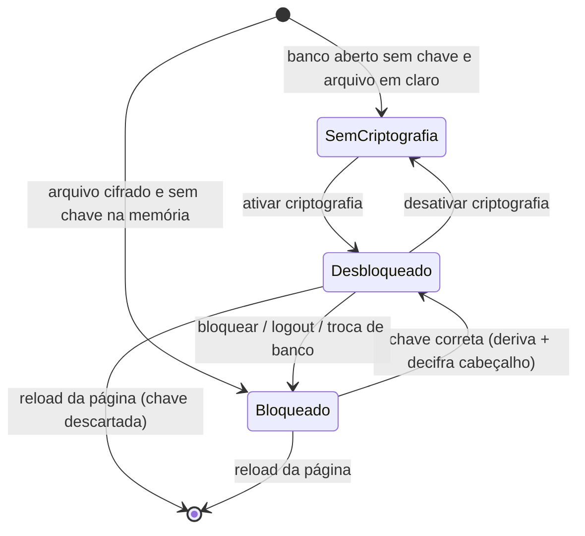
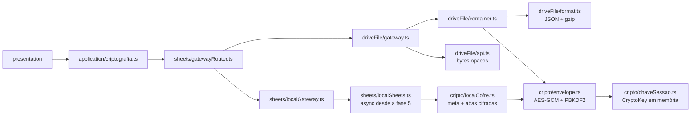
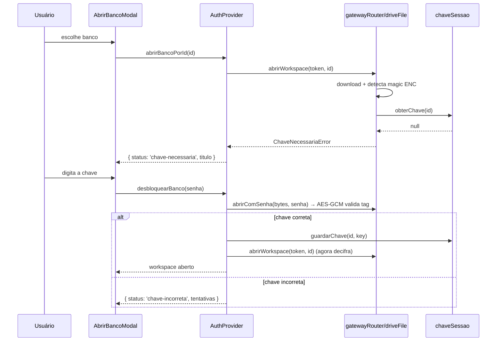

# Plano de implementação — Criptografia do banco de dados (chave em memória)

> Status: **planejado** (nada implementado).
> Objetivo: permitir que o usuário criptografe o conteúdo do banco da carteira
> por meio de um **toggle na tela de Configurações**. Com a criptografia ativa,
> o app pede a **chave** sempre que o banco é aberto (escolher banco existente
> ou criar) e passa a **cifrar/decifrar de forma transparente** na borda de
> armazenamento. A chave **nunca é persistida** — vive apenas na memória da aba
> e é descartada ao recarregar, deslogar, trocar de banco ou bloquear.

> **Decisões aprovadas (02/11/2026):**
> 1. Cifrar o **arquivo inteiro** (não campos isolados).
> 2. **Sem tamanho mínimo** de senha (apenas não vazia).
> 3. PBKDF2 com **600.000 iterações** (opção mais segura).
> 4. **"Bloquear agora" limpa o cache local**.
> 5. **Checkbox** no criar: se marcado, o banco nasce criptografado.
> 6. **Modo local entra na v1** (não é incremento).

---

## 1. Requisito (texto do usuário) e escopo

- Na tela de **Configurações** existe um **toggle** para criptografar "as
  informações da planilha" ou "a própria planilha".
- Quando o banco tem criptografia ativa, ao **escolher** (ou **criar**) o banco
  o sistema **pede a chave de descriptografia**, que **não é persistida**.
- A partir daí o aplicativo **cifra ao gravar** e **decifra ao ler**.

### Em escopo (v1)

1. Criptografia de **arquivo inteiro** no backend **`json`** (arquivo
   `*.json.gz` no Google Drive, `VITE_GOOGLE_BACKEND=json`).
2. Toggle em Configurações para **ativar** e **desativar**, com as validações
   necessárias (online/fila vazia no Google, confirmação da chave).
3. Prompt de chave no **abrir banco** e na **restauração da sessão** (reload),
   com tela de bloqueio.
4. Bloqueio manual ("Bloquear agora" — **limpa o cache local**) e limpeza da
   chave em logout/troca de banco.
5. **Checkbox "Criar banco criptografado"** na criação (nome + senha +
   confirmação): o arquivo nasce cifrado.
6. **Modo local (IndexedDB) também criptografado**: cofre local por banco,
   mesmos fluxos de desbloqueio/bloqueio.
7. Compatibilidade total com bancos **não criptografados** existentes (nenhuma
   migração obrigatória, nenhuma mudança de formato para quem não usa).

### Fora de escopo (v1) — ver seção 12

- Criptografia no backend **`sheets`** (planilha do Google Sheets).
- Criptografia do **cache de abas** (`cache.ts`) e do **outbox** (o bloqueio
  limpa o cache; o outbox é sincronizado/avisado — ver 6.4).
- Exportação `.ods`/backup criptografado.
- Recuperação de chave (não existe — por design).

---

## 2. Decisão central: o que exatamente é criptografado

O requisito abre duas leituras. O impacto de cada uma é **muito** diferente:

| Aspecto | **A) Arquivo inteiro** (recomendada) | **B) Campos/colunas sensíveis** |
| --- | --- | --- |
| Onde funciona | backend `json` (Drive) e, depois, modo local | qualquer backend, inclusive `sheets` |
| O que fica ilegível | 100% do conteúdo: todas as abas, tokens de API, histórico, anotações | apenas as colunas escolhidas (ex.: tokens, anotações) |
| Cabeçalhos / estrutura das abas | cifrados | legíveis |
| Fórmulas (`GOOGLEFINANCE`, somas da aba `Consolidado`) | não são usadas no backend JSON (o consolidado é calculado no cliente) | **quebram** nas células cifradas |
| Edição manual na planilha | impossível (é um blob) | parcial |
| Vazamento residual | nenhum conteúdo | metadados, cabeçalhos e colunas não cifradas |
| Complexidade | baixa: 1 ponto de composição no `encode`/`decode` do arquivo | alta: codec por coluna, migração, comparação, UI de seleção de campos |
| Risco de bug de dados | baixo | médio-alto |

**Decisão para v1: opção A (arquivo inteiro) no backend `json` e no modo local.**

Racional:

1. O backend `json` já é um **único arquivo** cujo conteúdo a aplicação
   serializa (`driveFile/format.ts`), então cifrar é uma composição de duas
   funções — não há código de domínio envolvido.
2. A opção A protege **tudo o que importa**, inclusive os tokens das APIs de
   cotação, que hoje ficam em texto puro na aba `Configuracoes`.
3. A opção B somente faria sentido para manter o backend `sheets` utilizável (ele
   depende de células legíveis para as fórmulas). Se o backend `sheets` for
   aposentado (`PLANO_DRIVE_JSON.md`), B perde a razão de existir.

**Impacto explícito da escolha:** com criptografia ativa, o arquivo no Drive
deixa de ser legível por qualquer outra ferramenta (Sheets, `gzcat`, editor de
texto, IA do Drive). O app é o único leitor, desde que tenha a chave. Também não
é possível editar a carteira "por fora" do app.

### 2.1 Impacto em leituras, edições e tradeoffs

**Leituras — o que muda na prática**

| Operação | Em claro (hoje) | Criptografado |
| --- | --- | --- |
| Abrir banco / 1ª leitura | download + gunzip + parse | download + **AES-GCM** + gunzip + parse (poucos ms) |
| Leituras seguintes na aba | cache em memória do gateway (`Map` de `Entry`) | **igual** — decifra uma vez e mantém o `DatabaseFile` em memória |
| Leitura offline | cache-first (IndexedDB) | igual, **desde que desbloqueado**; bloqueado, a chave é pedida antes de exibir dados |
| Custo perceptível | — | **PBKDF2 apenas no desbloqueio** (~0,3–1,5 s) e ao ativar/trocar a chave |
| Ferramentas externas (Sheets, preview do Drive, scripts) | leem tudo | não leem nada (nome/tamanho/datas do arquivo seguem visíveis) |
| Exportar `.ods` | texto puro | decifra em memória e exporta **texto puro** (aviso na UI) |

**Edições — o que muda na prática**

- **Dentro do app não muda nada**: formulários, operações, proventos, importação
  B3 e rebalanceamento continuam iguais. Cada gravação segue sendo um
  *read-modify-write*: o gateway decifra (ou usa a cópia em memória), aplica a
  mutação, **recifra** e envia com `etag`/`If-Match`.
- **Custo por gravação**: +1 AES-GCM do arquivo inteiro (poucos ms). Nenhuma
  requisição extra: o flush em lote continua **1 download + 1 upload**.
- **Edição fora do app: impossível**. Alterar os bytes no Drive quebra a tag
  GCM e o app recusa ("chave incorreta/arquivo inválido") — por design. O
  outbox preserva o que ainda não foi sincronizado.
- **Duas abas/dispositivos**: o controle de concorrência (`etag` + 412)
  continua igual — a versão remota é decifrada, as mutações pendentes são
  reaplicadas e o arquivo é regravado cifrado com **IV novo**.
- **Trocar a senha**: cifra tudo de novo (1 leitura + 1 upload). Os outros
  dispositivos passam a falhar até redigitar a nova chave.
- **Celular/PWA**: mesma UX; só o desbloqueio tem custo perceptível (spinner).

**Tradeoffs (o que se ganha × o que se perde)**

| Ganha | Perde |
| --- | --- |
| Confidencialidade em repouso: Google, backups e histórico de versões só veem ciphertext | Editabilidade: nem Sheets nem editor de texto abrem o arquivo |
| Tokens de API e histórico protegidos junto (não ficam em colunas legíveis) | Recuperação: senha esquecida = dados perdidos (não há "esqueci a senha") |
| Um único ponto de implementação, sem tocar domínio/repositórios | Acesso offline exige desbloqueio (a chave não é persistida) |
| Concorrência (`etag`) e lote (1 download + 1 upload) preservados | Metadados (nome do arquivo, tamanho, datas) continuam visíveis |
| Bancos já existentes continuam funcionando em claro | `.ods` exportado, cache de abas e outbox continuam em claro |

**Resumo:** para o usuário, ler e editar continuam iguais — muda o que o
*resto do mundo* consegue fazer com os dados. O preço é o desbloqueio por
sessão e a impossibilidade de recuperar a chave.

### 2.2 E o `GOOGLEFINANCE` continua funcionando?

Depende do backend, e a resposta é **sim nos dois casos cobertos pela v1**:

| Situação | `GOOGLEFINANCE` | Por quê |
| --- | --- | --- |
| Backend `sheets` (planilha do Google) | **continua funcionando** | a criptografia fica **desabilitada** nesse backend; as células seguem legíveis |
| Backend `json` (arquivo no Drive) | **não existe** (não há planilha nem motor de fórmulas) | preços vêm das APIs de cotação e o `Consolidado` é calculado no cliente |
| Modo local | **não existe** | idem; a aba recebe valores estáticos (`buildConsolidadoRowsEstaticas`) |

Detalhes:

- No backend `sheets`, `sheetFormulas.ts` grava
  `=GOOGLEFINANCE("BVMF:"&$A2;"price")` em `Consolidado!E` e
  `=GOOGLEFINANCE("BVMF:"&$A2;"priceopen")` em `Consolidado!K` com
  `USER_ENTERED`, e o app lê o valor calculado. Nada muda com este plano.
- No backend `json`, um arquivo `.json.gz` não é avaliado pelo Google: a fórmula
  não teria efeito mesmo **sem** criptografia. Por isso o preço vem das
  integrações (`Brapi` → `Mais Retorno`) e o dashboard resolve o consolidado no
  cliente.
- **Se um dia** habilitarmos a opção B (cifrar células) no backend `sheets`,
  aí o `GOOGLEFINANCE` **quebra**: `$A2` (ticker) e `E`/`K` (preço) ficariam
  cifrados e a fórmula devolveria `#N/A`; por consequência, as colunas F–J e L
  (que referenciam C/D/E/K e o total de G) também falhariam. É exatamente por
  isso que o backend `sheets` fica fora do escopo da v1.

**Resposta curta:** cifrar o arquivo inteiro **não afeta** o `GOOGLEFINANCE`,
porque ele só existe no backend onde a criptografia não é aplicada.

### Comportamento por modo/backend

| Combinação | Toggle | Observação |
| --- | --- | --- |
| `google` + `json` | **habilitado** | v1 completa |
| `google` + `sheets` | **desabilitado** com explicação | cifrar células inviabiliza fórmulas e edição manual (opção B seria necessária) |
| `local` (IndexedDB) | **habilitado** | cifra cada matriz de aba no IndexedDB; exige tornar `localSheets.ts` assíncrono (seção 6.9) |

---

## 3. Modelo de segurança

### 3.1 Primitivas (Web Crypto — nenhuma dependência nova)

| Item | Escolha | Motivo |
| --- | --- | --- |
| Cifra | **AES-256-GCM** | autenticada (detecta adulteração e chave errada), nativa no navegador |
| Derivação de chave | **PBKDF2-HMAC-SHA256**, 600.000 iterações, salt de 16 bytes | recomendação OWASP; `CryptoKey` **não-extraível** |
| IV | 12 bytes aleatórios **por gravação** | GCM exige IV único; nunca reaproveitar |
| Tag | 128 bits (padrão) | integridade + autenticidade |
| AAD | os bytes do cabeçalho em claro | impede trocar salt/iterações/IV sem invalidar a tag |
| Chave em memória | objeto `CryptoKey` (`extractable: false`) em módulo | não é possível exportar o material da chave |
| Persistência da chave | **nenhuma** (nem `localStorage`, nem `IndexedDB`, nem `sessionStorage`) | requisito explícito |

**Política de senha (decisão):** **sem tamanho mínimo** e sem exigência de
classes. A força vem do PBKDF2. A UI apenas (a) impede senha **vazia** e (b)
mostra uma dica de qualidade ("uma frase longa é melhor que uma palavra
curta"). Não existe "esqueci a senha".

> Contexto seguro: Web Crypto exige HTTPS ou `localhost`. O app já é PWA
> publicado em HTTPS; em `http://` fora de `localhost` o toggle fica desabilitado
> (`isCriptografiaSuportada() === false`).

### 3.2 O que a criptografia **não** protege (documentar na UI)

- O **cache de abas** (`infrastructure/cache.ts`) continua em texto puro no
  IndexedDB, assim como o **outbox**. Quem tiver acesso ao perfil do navegador
  consegue ler os últimos dados sincronizados.
  - Mitigações v1: **"Bloquear agora" limpa o cache de abas** do banco
    (decisão) e esquece a chave; logout idem. O **outbox** é sincronizado antes
    de bloquear; se não for possível (offline), o bloqueio avisa que as
    alterações pendentes seguem no navegador em claro até o próximo flush.
- O arquivo exportado em `.ods` é **texto puro** (aviso na tela de exportação
  quando o banco está cifrado).
- A **chave** não tem recuperação: se perdida, os dados são irrecuperáveis.

### 3.3 Estados da chave



- `Desbloqueado` vale **por banco** (`Map<spreadsheetId, CryptoKey>`), porque o
  usuário pode alternar entre bancos com chaves diferentes na mesma aba.
- Ao recarregar a página a chave se perde **mesmo que o workspace continue
  salvo** (isso é o comportamento desejado).
- No **modo local** a chave é guardada sob o id sintético `local`
  (`WORKSPACE_LOCAL_ID`), então o desbloqueio do banco do navegador segue o
  mesmo fluxo do banco no Drive.

---

## 4. Formato do arquivo (container)

O arquivo atual é `gzip(JSON)`. Com criptografia passa a ser
`cabeçalho-em-claro + AES-GCM(gzip(JSON))` — **comprimir antes de cifrar**
(menos bytes cifrados, mesma semântica).

```
offset   conteúdo
0        17 bytes: magic ASCII "MINHASACOES-ENC1" + "\n"
17       cabeçalho JSON (UTF-8) + "\n"
...      ciphertext (AES-256-GCM de gzip(JSON))
```

Cabeçalho (em claro, é o que permite detectar o estado **sem** a chave):

```json
{
  "v": 1,
  "kdf": { "n": "PBKDF2-SHA256", "i": 600000, "s": "<base64 16 bytes>" },
  "cifra": { "n": "AES-256-GCM", "iv": "<base64 12 bytes>" }
}
```

Regras:

- **Detecção**: `bytes` começam com o magic → cifrado. Caso contrário, o arquivo
  é o formato atual (`0x1f 0x8b` = gzip ou `{` = fallback sem compressão). A
  detecção **nunca** usa "não é gzip".
- **Sem versão nova no JSON interno**: `{ version, sheets }` continua igual
  dentro do envelope; `DATABASE_FILE_VERSION` não muda.
- **Salt e IV novos a cada gravação**: o cabeçalho é reescrito junto com o
  arquivo (é parte do mesmo upload). O salt pode ser mantido por banco (só muda
  ao trocar a chave); o IV **sempre** muda.
- **Migração de arquivo em claro → cifrado**: mesma operação de gravação (lê,
  cifra, sobe). Nenhuma versão intermediária.
- **Nome e MIME do arquivo não mudam** (`<título>.json.gz`,
  `application/gzip`): a listagem (`name contains '.json.gz'`) continua
  funcionando.

---

## 5. Arquitetura e novos módulos

A criptografia é um **detalhe de infraestrutura**: fica abaixo do
`sheets/gatewayRouter.ts`, no mesmo nível do transporte. Nenhum repositório,
codec, caso de uso de domínio ou componente de dados precisa saber que ela existe.



### 5.1 Novos arquivos

```
src/domain/
└── criptografia.ts              # puro: validação de chave, cabeçalho, base64, constantes

src/infrastructure/cripto/
├── webCrypto.ts                 # derivarChave / cifrarBytes / decifrarBytes + isCriptografiaSuportada
├── envelope.ts                  # monta/lê o container (magic + cabeçalho + ciphertext)
├── chaveSessao.ts               # CryptoKey por banco (memória) + bloqueio + erros tipados
├── localCofre.ts                # cofre do modo local (meta + abas cifradas no IndexedDB)
└── *.test.ts

src/application/
└── criptografia.ts              # casos de uso: ativar, desativar, bloquear, estado
```

Alterados (superfície):

```
src/infrastructure/driveFile/gateway.ts   # Entry.criptografado, create/load com chave, re-encrypt
src/infrastructure/sheets/gatewayRouter.ts# repassa opções e expõe estado de criptografia
src/infrastructure/sheets/localSheets.ts  # matrizes cifradas + cofre local (API vira async)
src/infrastructure/sheets/localGateway.ts # await nas leituras/escritas
src/domain/workspace.ts                   # SpreadsheetWorkspace.criptografia?: 'nenhuma' | 'total'
src/presentation/app/providers/AuthProvider.tsx + authContext.ts
src/presentation/app/routes/RouteGuards.tsx
src/presentation/features/auth/WorkspaceSetup.tsx, AbrirBancoModal.tsx
src/presentation/features/auth/DesbloquearBanco.tsx   # novo (tela de bloqueio)
src/presentation/features/configuracoes/ConfiguracoesPage.tsx
src/presentation/features/diagnostico/DiagnosticoPage.tsx
src/presentation/components/Switch.tsx    # novo (toggle acessível, role="switch")
```

### 5.2 Contratos (assinaturas propostas)

`domain/criptografia.ts` (puro, sem `crypto`):

```ts
export const CRIPTO_MAGIC = 'MINHASACOES-ENC1'
export const CRIPTO_VERSAO = 1
export const KDF_ITERACOES_PADRAO = 600_000 // decisão: configuração mais segura

export interface ParametrosKdf {
  algoritmo: 'PBKDF2-SHA256'
  iteracoes: number
  salt: string // base64
}

export interface CabecalhoCripto {
  versao: number
  kdf: ParametrosKdf
  cifra: { algoritmo: 'AES-256-GCM'; iv: string }
}

// sem mínimo de tamanho: apenas rejeita vazia (decisão)
export function validarChave(chave: string): { ok: true } | { ok: false; motivo: string }
export function ehBytesCriptografados(bytes: Uint8Array): boolean
export function lerCabecalho(bytes: Uint8Array): CabecalhoCripto | null
export function montarCabecalho(kdf: ParametrosKdf, iv: Uint8Array): Uint8Array
```

`infrastructure/cripto/webCrypto.ts`:

```ts
export function isCriptografiaSuportada(): boolean
export async function derivarChave(senha: string, kdf: ParametrosKdf): Promise<CryptoKey>
export async function cifrarBytes(dados: Uint8Array, chave: CryptoKey, iv: Uint8Array, aad: Uint8Array): Promise<Uint8Array>
export async function decifrarBytes(dados: Uint8Array, chave: CryptoKey, iv: Uint8Array, aad: Uint8Array): Promise<Uint8Array>
```

`infrastructure/cripto/chaveSessao.ts`:

```ts
export function temChave(spreadsheetId: string): boolean
export function guardarChave(spreadsheetId: string, chave: CryptoKey): void
export function obterChave(spreadsheetId: string): CryptoKey | null
export function esquecerChave(spreadsheetId: string): void
export function esquecerTodasAsChaves(): void
```

`infrastructure/cripto/localCofre.ts` (modo local):

```ts
export interface MetaCofreLocal {
  versao: number
  kdf: ParametrosKdf
  /** bloco fixo cifrado usado para validar a senha sem ler todas as abas */
  verificador: string
}

export function lerMetaCofreLocal(): MetaCofreLocal | null
export async function criarCofreLocal(senha: string): Promise<CryptoKey>
export async function abrirCofreLocal(senha: string): Promise<CryptoKey>
```

`infrastructure/cripto/envelope.ts`:

```ts
export function estaCifrado(bytes: Uint8Array): boolean
export async function cifrarArquivo(plano: Uint8Array, senha: string): Promise<Uint8Array>
export async function decifrarArquivo(cifrado: Uint8Array, chave: CryptoKey): Promise<Uint8Array>
export async function abrirComSenha(cifrado: Uint8Array, senha: string): Promise<CryptoKey>
export class ChaveIncorretaError extends Error {}
```

`driveFile/container.ts` (composição, mantém `format.ts` puro e sem cripto):

```ts
export async function codificarBanco(
  sheets: DatabaseSheets, version: number, chave: CryptoKey | null,
): Promise<Uint8Array>

export async function decodificarBanco(
  bytes: Uint8Array, chave: CryptoKey | null,
): Promise<{ db: DatabaseFile; raw: unknown; criptografado: boolean }>
```

Erros tipados (herdam de `SheetsApiError` para não quebrar
`describeSheetsError`, `isOfflineWriteError` e o outbox):

```ts
// status 423 (Locked) — a UI reage abrindo o modal de senha
export class ChaveNecessariaError extends SheetsApiError {
  readonly codigo = 'CHAVE_NECESSARIA'
}
export class ChaveIncorretaError extends SheetsApiError {
  readonly codigo = 'CHAVE_INCORRETA'
}
```

---

## 6. Mudanças por arquivo (detalhado)

### 6.1 `src/domain/workspace.ts`

- `SpreadsheetWorkspace.criptografia?: 'nenhuma' | 'total'` (opcional para não
  invalidar workspaces já salvos — os antigos são tratados como `'nenhuma'`).
- `PlanilhaExistente.criptografada?: boolean` (opcional; só preenchido se um dia
  usarmos `appProperties` — ver 12.3).

### 6.2 `src/infrastructure/driveFile/gateway.ts`

- `Entry` ganha `criptografado: boolean` e passa a ser a **fonte de verdade** do
  estado em sessão.
- `fetchEntry`: lê bytes → `estaCifrado`?
  - não → fluxo atual (`parseDatabaseBytes`).
  - sim → `obterChave(fileId)`; se ausente, lança `ChaveNecessariaError`; se
    presente, `decifrarArquivo` (falha de tag → `ChaveIncorretaError`).
- `uploadDatabase`: `codificarBanco(..., entry.criptografado ? obterChave(fileId) : null)`.
  Se a chave desapareceu da memória no meio da sessão → `ChaveNecessariaError`
  (nunca gravar em claro por engano).
- `resolveConflict` (412): decifra a versão remota com a mesma chave e reescreve
  cifrado — nada de degradar para texto puro em conflito.
- `createDefaultSpreadsheet(accessToken, title, opcoes?: { chave?: CryptoKey })`:
  cria já cifrado quando `opcoes.chave` existir.
- Nova função `alterarCriptografia(accessToken, spreadsheetId, chave: CryptoKey | null)`:
  força releitura do arquivo (ignora cache), troca o estado e faz **um** upload
  (com `etag`/`If-Match`). É o único caminho de ativar/desativar/trocar chave.
  - `chave = null` → grava em claro (exige chave atual na memória para ler).
  - `chave` (nova) → relê com a chave atual, regrava com a nova.
- Nova função `estadoCriptografia(accessToken, spreadsheetId): Promise<'nenhuma' | 'total'>`
  (usa o cache da sessão; se não houver entrada, lê o arquivo).
- `loadSpreadsheetWorkspace`: continua migrando/normalizando cabeçalhos; quando
  migra um arquivo cifrado, reescreve **cifrado** (mesma chave) e devolve
  `workspace.criptografia = 'total'`.

### 6.3 `src/infrastructure/sheets/gatewayRouter.ts`

- `criarWorkspace(accessToken, title, opcoes?)` → repassa `opcoes.chave` ao
  backend `json` (no `sheets`/local ignora).
- `abrirWorkspace` inalterado na assinatura (erros tipados sobem).
- Novas exportações: `estadoCriptografia`, `alterarCriptografia` e
  `criptografiaDisponivel()` — `(isJsonBackend() || isModoLocal()) &&
  isCriptografiaSuportada()` —, para a UI decidir se mostra o toggle habilitado.

### 6.4 `src/application/criptografia.ts` (novo caso de uso)

```ts
export async function ativarCriptografia(ctx: RepositoryContext, senha: string): Promise<void>
export async function desativarCriptografia(ctx: RepositoryContext, senhaAtual?: string): Promise<void>
export async function bloquearBanco(spreadsheetId: string): Promise<void>
export async function estadoDoBanco(
  ctx: RepositoryContext,
): Promise<{ estado: 'nenhuma' | 'total'; desbloqueado: boolean }>
```

Regras do caso de uso:

1. **Exige online apenas no Google** (`isOnline()`); senão erro "Conecte-se para
   alterar a criptografia". No **modo local** ativar/desativar funciona offline.
2. **Exige fila offline vazia apenas no Google** (`contarPendencias() === 0`);
   senão pede sincronizar antes (evita cifrar um estado ainda não confirmado).
3. `ativar`: valida a senha (**apenas não vazia**), deriva a chave,
   `alterarCriptografia(..., chave)` (Google) ou cifra as abas + grava a meta
   do cofre (local), `guardarChave`, atualiza `workspace.criptografia`, limpa
   caches de leitura (`invalidateSpreadsheetCache`) para forçar reresposta do
   gateway.
4. `desativar`: usa a chave da sessão (ou deriva da senha informada),
   `alterarCriptografia(..., null)` (Google) ou decifra as abas e remove a meta
   do cofre (local), `esquecerChave`, atualiza workspace.
5. `bloquear` (**decisão: limpa o cache local**): tenta sincronizar o outbox;
   `invalidateSpreadsheetCache` + `esquecerChave`; se houver pendências e não
   for possível sincronizar, mantém o outbox e retorna aviso para a UI. Muda o
   status do provider para `bloqueado`.
6. `estado`: no Google lê o cabeçalho do arquivo (magic); no local lê
   `local-cripto::meta`. Nunca deriva chave só para consultar.

### 6.5 `AuthProvider` / `authContext`

- `AuthStatus` ganha `'bloqueado'`.
- Novo campo `criptografia: { estado: 'nenhuma' | 'total'; desbloqueado: boolean }`.
- `abrirBancoPorId` passa a devolver um resultado discriminado:

```ts
type ResultadoAbrirBanco =
  | { status: 'aberto' }
  | { status: 'chave-necessaria'; titulo: string }
  | { status: 'erro' }
```

- Nova ação `desbloquearBanco(senha: string): Promise<ResultadoDesbloqueio>`:
  usa `abrirComSenha` sobre o arquivo para validar a chave (falha → contador de
  tentativas + atraso progressivo 0s/1s/2s/5s), guarda a chave e chama
  `abrirWorkspace` de novo; em sucesso salva o workspace e muda o status.
- Bootstrap (`useEffect` inicial): se `workspaceStorage.load()?.criptografia === 'total'`
  e não há chave → `status = 'bloqueado'`, **sem** rede e **sem** liberar as
  telas de dados (decisão: o cache em claro não deve ser exibido sem chave).
  Vale igualmente no **modo local** (workspace `local` com cofre).
- `criarBanco(title, { chave })`: quando o checkbox "Criar banco criptografado"
  está marcado, deriva a chave, cria o arquivo **já cifrado** e a mantém na
  memória (o banco nasce desbloqueado nesta sessão).
- `logout` e troca de banco → `esquecerTodasAsChaves()`.
- Em qualquer operação que receba `ChaveNecessariaError`/`ChaveIncorretaError`
  (ex.: `ensureRequiredSheets` em background), o provider muda para `'bloqueado'`
  em vez de mostrar erro genérico.

### 6.6 Apresentação

- **`Switch.tsx`** (novo): toggle acessível (`role="switch"`, `aria-checked`,
  navegável por teclado) no padrão visual dos cards atuais.
- **`ConfiguracoesPage.tsx`**: novo card **"Segurança do banco"** entre
  "Armazenamento e exportação" e "Layout do app":
  - linha de estado: `Sem criptografia` / `Arquivo criptografado (AES-256-GCM)`;
  - toggle desabilitado com `title`/texto de motivo (backend `sheets`, offline
    [só no Google], fila pendente [só no Google], Web Crypto indisponível);
  - **ativar** → `Modal` com senha + confirmação + medidor simples de força +
    aviso "sem a chave os dados são irrecuperáveis" + botão "Exportar backup
    antes" (reusa `exportarPlanilhaOds`);
  - **desativar** → `Modal` pedindo a chave (se não estiver na memória) e
    confirmando que o arquivo voltará a ser legível;
  - quando cifrado: botão **"Bloquear agora"** e aviso de que exportar `.ods`
    gera arquivo **em claro**.
- **`WorkspaceSetup.tsx`**: checkbox **"Criar banco criptografado"** (v1),
  desabilitado se Web Crypto indisponível. Marcado, revela **senha +
  confirmação** e o botão de criar passa a gerar o arquivo **já cifrado**. O
  fluxo de nome duplicado ("criar nova mesmo assim") **mantém** a escolha de
  criptografia.
- **`AbrirBancoModal.tsx`**: ao receber `chave-necessaria`, abre o
  `DesbloquearBancoModal` com o título do banco; ícone de cadeado na lista
  quando `banco.criptografada` vier preenchido (só quando o item 12.3 existir).
- **`DesbloquearBanco.tsx`** (novo, em `features/auth`): tela de bloqueio usada
  pelo `ProtectedRoute`:
  - título "Banco de dados protegido", nome do banco, campo de senha,
    botão **Desbloquear** (spinner durante PBKDF2);
  - ações secundárias: **"Esquecer este banco neste dispositivo"**
    (`workspaceStorage.clear()` + `clearAllSheetCache()` + logout) e
    **"Usar sem Google"**;
  - mensagens: chave incorreta (com tentativas restantes) e aviso de que a
    chave não é armazenada.
- **`RouteGuards.tsx`**: `status === 'bloqueado'` → renderiza
  `DesbloquearBanco` em vez das rotas protegidas.
- **`DiagnosticoPage.tsx`**: linha "Criptografia: ativa (AES-256-GCM /
  PBKDF2 600k) · desbloqueado" + botão "Bloquear agora".

### 6.7 Sincronização e offline

- `application/sync.ts`: no início do flush, se o banco está cifrado e a chave
  não está na memória → **não** executa e devolve um resultado
  `{ status: 'bloqueado' }` (as mutações permanecem no outbox, como offline).
- `presentation/hooks/useSync.ts`: não agenda flush enquanto
  `status === 'bloqueado'`; ao desbloquear, dispara um flush imediato.
- `SyncStatusBadge`: estado adicional "Bloqueado — desbloqueie para sincronizar".
- `describeSheetsError` (ou um wrapper): 423 → "Este banco está criptografado.
  Informe a chave para continuar."; 400 de tag → "Chave incorreta."

### 6.8 Diagnóstico (`application/diagnostics.ts`)

- Acrescentar `criptografia: { estado, algoritmo, kdf, desbloqueado }` ao
  relatório (sem expor chave/salt).

### 6.9 Modo local (`localSheets.ts`) — v1

No modo local o "arquivo" são as matrizes em `kvStore`
(`local-sheet::<aba>`). O cofre local funciona assim:

- **Meta** em `local-cripto::meta`:
  `{ versao, kdf: { iteracoes, salt }, verificador }`. O `verificador` é um
  bloco fixo cifrado com a chave, usado para validar a senha **sem** decifrar
  todas as abas. O salt é único do cofre → PBKDF2 roda **uma vez** por
  desbloqueio.
- **Abas**: cada matriz vira `{ enc: { iv, dados } }` (AES-GCM da matriz
  serializada). Gravar uma aba re-cifra apenas aquela aba.
- `localSheets.ts` passa a ser **assíncrono**: `readLocalSheet`,
  `writeLocalSheet`, `readSheetRange`, `writeSheetRange`,
  `appendValuesToSheet`, `clearSheetRange`, `ensureLocalSheetsWithHeaders`,
  `listLocalSheetNames`, `clearLocalSheets`. `localGateway.ts` já é `async` —
  só recebe os `await` (inclusive em `localLoadWorkspace`).
- Revisar chamadores síncronos (ex.: `clearLocalSheets()` em logout/limpeza) e
  ajustar para `await`.
- Ativar em banco local existente: cifra cada aba em claro e substitui o valor
  na mesma chave de KV (não resta cópia em claro da mesma aba).
- `prepararWorkspaceLocal`/`localLoadWorkspace`: se existir cofre e não houver
  chave → `ChaveNecessariaError` (mesmo fluxo de bloqueio do Google).

---

## 7. Fluxos de UX

### 7.1 Abrir banco criptografado



### 7.2 Ativar criptografia

1. Configurações → card "Segurança do banco" → toggle.
2. Modal: senha + confirmação + aviso irreversível + sugestão de backup.
3. App verifica online/fila vazia (Google) e mostra spinner ("Criptografando
   banco…"); no modo local não há verificação de rede.
4. `alterarCriptografia` regrava o arquivo (ou as abas locais); estado muda para
   "Arquivo criptografado"; a chave fica na memória até bloquear/recarregar.

### 7.3 Recarregar a página com banco cifrado

- `workspace.criptografia === 'total'` e sem chave → tela de bloqueio **antes**
  de qualquer leitura de dados (vale para Drive e para o modo local).
- Desbloquear → dashboard carrega normalmente (cache-first + sincronização).
- "Bloquear agora" limpa o cache de abas antes de mudar para `bloqueado`.
- "Esquecer este banco" → volta para a tela de login/setup.

### 7.4 Trocar de banco

- Cada banco tem a própria chave; abrir outro banco pede a chave dele.
- Voltar ao anterior na mesma aba reutiliza a chave ainda em memória.

### 7.5 Mensagens e estados de erro

| Situação | Mensagem |
| --- | --- |
| chave ausente | "Este banco está criptografado. Informe a chave para continuar." |
| chave errada | "Chave incorreta. Verifique e tente novamente." (+ atraso progressivo) |
| senha vazia | "Informe uma senha (não há mínimo de tamanho, mas ela não pode ficar em branco)." |
| offline ao ativar/desativar (Google) | "Conecte-se à internet para alterar a criptografia." |
| fila pendente (Google) | "Sincronize as alterações pendentes antes de alterar a criptografia." |
| backend `sheets` | "Disponível apenas no banco em arquivo (Drive JSON) e no modo local. No Google Sheets as células precisam ficar legíveis." |
| bloqueio com pendências offline | "Criptografia bloqueada. Há N alterações pendentes que serão enviadas após o desbloqueio." |
| Web Crypto ausente/HTTP | "Seu navegador não suporta criptografia neste contexto (é necessário HTTPS)." |
| exportação `.ods` | "O arquivo .ods é exportado sem criptografia." |

### 7.6 Criar banco já criptografado

1. `WorkspaceSetup` → marcar o checkbox **"Criar banco criptografado"**.
2. Campos de **senha** e **confirmação** aparecem (sem exigência de tamanho).
3. App valida e chama `criarBanco(title, { chave })`, que cria o arquivo com
   cabeçalho + ciphertext (ou o cofre local, no modo local).
4. Banco já abre desbloqueado na sessão; ao recarregar, a tela de bloqueio
   aparece.

### 7.7 Banco local criptografado

1. Modo local → Configurações → toggle → senha + confirmação.
2. `ativarCriptografia` cifra todas as abas em `local-sheet::<aba>` e grava a
   meta do cofre.
3. Reload → `DesbloquearBanco` (título "Minhas Ações — neste navegador") →
   senha → dashboard.
4. "Bloquear agora" limpa o cache de abas e esquece a chave; as abas cifradas
   continuam no IndexedDB.

---

## 8. Impactos nas funcionalidades existentes

| Funcionalidade | Impacto | Ação no plano |
| --- | --- | --- |
| Repositórios/codecs/domínio | **nenhum** | — |
| `cache.ts` / `offlineRepositories` | gravam o mesmo conteúdo (em claro) | limpar no bloquear/logout; documentar |
| `outbox` / `sync` | flush exige chave; pausa quando bloqueado | 6.7 |
| Conflito 412 | precisa decifrar a versão remota | 6.2 |
| Exportar `.ods` | funciona (decifra em memória) mas gera arquivo em claro | aviso na UI |
| Importar `.ods` | funciona; regrava cifrado | nenhum código extra |
| Cotações/`GOOGLEFINANCE` | no backend JSON já são client-side | — |
| Histórico/consolidado | inalterados | — |
| PWA | service worker não cacheia dados (já é assim) | — |
| Diagnóstico | novas linhas | 6.8 |
| Multi-dispositivo | cada dispositivo digita a chave; trocar a chave invalida a chave antiga nos outros (ChaveIncorreta até redigitar) | documentar |
| Duas abas abertas | a chave é por aba; a segunda aba pede a chave | documentar |
| Modo local | matrizes passam a ser cifradas no IndexedDB; `localSheets` vira async | 6.9 |
| Criação do banco | checkbox de criptografia altera o fluxo de `criarBanco` | 6.5 / 6.6 |

---

## 9. Fases de implementação

### Fase 0 — Decisões e textos (concluída em 02/11/2026)

- [x] Opção **A (arquivo inteiro)**.
- [x] **Sem tamanho mínimo** de senha.
- [x] PBKDF2 **600.000** iterações.
- [x] **"Bloquear agora" limpa o cache local**.
- [x] **Checkbox** "Criar banco criptografado" na criação.
- [x] **Modo local na v1**.
- [ ] Revisar os textos finais (tabela 7.5) durante a implementação.

**Aceite:** este documento com as decisões acima registradas.

### Fase 1 — Núcleo criptográfico (1–1,5 dia)

- [ ] `domain/criptografia.ts` (validação, magic, cabeçalho, base64).
- [ ] `infrastructure/cripto/webCrypto.ts` (derivar/cifrar/decifrar + suporte).
- [ ] `infrastructure/cripto/envelope.ts` (container + `ChaveIncorretaError`).
- [ ] `infrastructure/cripto/chaveSessao.ts` (mapa por banco + esquecer).

**Aceite:** round-trip cifra/decifra; chave errada lança erro tipado; cabeçalho
adulterado falha a tag; testes unitários verdes com Node 20.

### Fase 2 — Container no backend JSON (1–1,5 dia)

- [ ] `driveFile/container.ts` (`codificarBanco`/`decodificarBanco`).
- [ ] `gateway.ts`: `Entry.criptografado`, `fetchEntry`, `uploadDatabase`,
  `resolveConflict`, `createDefaultSpreadsheet(opcoes)`,
  `alterarCriptografia`, `estadoCriptografia`; erros 423 tipados.
- [ ] `gatewayRouter.ts`: repasses e `criptografiaDisponivel()`.
- [ ] `workspace.criptografia` propagado em `loadSpreadsheetWorkspace`.

**Aceite:** banco em claro continua abrindo igual (compatibilidade); banco
criado com chave abre só com a chave; conflito 412 resolve cifrado; arquivo
baixado do Drive não é gzip legível quando cifrado.

### Fase 3 — Abertura, bloqueio e restauração de sessão (2 dias)

- [ ] `AuthProvider`/`authContext`: `status: 'bloqueado'`, resultados
  discriminados, `desbloquearBanco`, `bloquearBanco`, limpeza de chaves.
- [ ] `RouteGuards` + `DesbloquearBanco` (tela) + atalho no `AbrirBancoModal`.
- [ ] `useSync`/`SyncStatusBadge` respeitando o bloqueio.
- [ ] Contador/atraso de tentativas.

**Aceite:** fluxo completo abrir → senha → dashboard; reload pede a chave;
"Esquecer banco" limpa workspace + cache; logout esquece as chaves.

### Fase 4 — Configurações, toggle e criação (2 dias)

- [ ] `application/criptografia.ts` (ativar/desativar/bloquear/estado).
- [ ] `Switch.tsx` + card "Segurança do banco" com estados e avisos.
- [ ] Modais de ativação/desativação; bloqueio de ações offline/fila pendente
  (apenas no Google).
- [ ] **`WorkspaceSetup`: checkbox "Criar banco criptografado"** (senha +
  confirmação), com a escolha preservada no fluxo de nome duplicado.
- [ ] "Bloquear agora" limpando o cache de abas (e avisando sobre pendências).

**Aceite:** toggle reflete o estado real do arquivo; ativar/desativar só com
online e fila vazia no Google; criação com checkbox gera arquivo cifrado desde
o primeiro byte; mensagens da tabela 7.5 aparecem nos cenários corretos.

### Fase 5 — Modo local (2–2,5 dias)

- [ ] `cripto/localCofre.ts` (meta + verificador + cifrar/decifrar aba).
- [ ] Tornar `localSheets.ts` **assíncrono** e guardar cada matriz como
  envelope cifrado em `local-sheet::<aba>`.
- [ ] `localGateway.ts`: `await` em todas as leituras/escritas (inclui
  `localLoadWorkspace`).
- [ ] Revisar chamadores síncronos de `localSheets` (logout, limpeza,
  diagnóstico) e ajustar para `await`.
- [ ] Fluxo de bloqueio/desbloqueio do workspace `local` (mesma tela).
- [ ] Habilitar o toggle quando `modo === 'local'`.

**Aceite:** banco local cifrado abre com senha, não grava matriz em claro no
IndexedDB, exporta `.ods` com aviso e os testes existentes de
`localGateway`/`localSheets` continuam verdes após a mudança para async.

### Fase 6 — Diagnóstico, docs e memória (0,5 dia)

- [ ] Linha de criptografia + "Bloquear agora" em `DiagnosticoPage`.
- [ ] `ARCHITECTURE.md` (adaptador `cripto/`, cofre local, formato do
  container), `README.md` (limitações: cache/`.ods` em claro), `.env.example`
  (nada novo).
- [ ] Atualizar `/memories/repo/renda.md` com a decisão e as armadilhas.

**Aceite:** documentação revisada; nenhuma referência a "planejado" sobrando.

> Estimativa total v1 (fases 0–6): **10–12 dias** de desenvolvimento, incluindo
> testes.

---

## 10. Testes

### Unitários (Vitest, Node 20)

- `domain/criptografia.test.ts`: validação de senha (**só vazio é rejeitado**;
  qualquer tamanho é aceito), parsing e rejeição de cabeçalho inválido,
  detecção de magic, base64 ida-e-volta.
- `cripto/envelope.test.ts`: round-trip; **chave errada** → `ChaveIncorretaError`;
  **bit flip** no ciphertext e no cabeçalho → erro; dois arquivos do mesmo
  conteúdo têm ciphertext/IV diferentes.
- `driveFile/container.test.ts`: compatibilidade (encode sem chave = gzip atual);
  decode de arquivo em claro com `chave = null`; decode cifrado com chave
  correta; `criptografado` reportado.
- `driveFile/gateway.test.ts` (ampliar): `fetchEntry` sem chave → 423;
  `alterarCriptografia` ida e volta; 412 com arquivo cifrado; migração de
  cabeçalhos grava cifrado.
- `chaveSessao.test.ts`: guardar/obter/esquecer por banco; `esquecerTodas`.
- `cripto/localCofre.test.ts`: criar/abrir cofre; senha errada no `verificador`;
  cifrar/decifrar aba; ativar em banco local existente substitui a matriz em
  claro; `localSheets` async continua idempotente em `ensureLocalSheetsWithHeaders`.

### Integração/UI (manual ou com Testing Library, se houver)

Cenários obrigatórios:

1. Criar banco → ativar criptografia → baixar o arquivo do Drive → `gzip -d`
   falha (arquivo cifrado).
2. Recarregar o app → tela de bloqueio → senha correta → dados intactos.
3. Senha errada 3× → mensagens e atraso progressivo; nenhum dado alterado.
4. Desativar criptografia → arquivo volta a ser gzip legível.
5. Ativar com fila offline pendente → bloqueado com mensagem.
6. Offline com banco desbloqueado → leitura do cache e escrita no outbox;
   reconectar → flush cifrado.
7. Offline com banco bloqueado → app bloqueado, sem flush.
8. Conflito 412 (duas abas/dispositivos) em banco cifrado → resolve e mantém
   cifrado.
9. Exportar `.ods` de banco cifrado → arquivo abre com aviso exibido.
10. Importar `.ods` em banco cifrado → dados gravados e arquivo segue cifrado.
11. `VITE_GOOGLE_BACKEND=sheets` → toggle desabilitado com explicação.
12. Criar banco com o checkbox marcado → arquivo nasce cifrado e a sessão já
   abre desbloqueada; reload pede a chave.
13. Modo local: ativar criptografia → reload → tela de bloqueio → senha → abas
   intactas; inspecionar o IndexedDB e **não** encontrar texto legível das abas.
14. Modo local bloqueado e offline → bloqueio funciona sem rede; desbloqueio
   também.
15. "Bloquear agora" → cache de abas some (dashboard não mostra dados antes do
   desbloqueio) e a chave não é mais usada.

---

## 11. Riscos e mitigações

| Risco | Impacto | Mitigação |
| --- | --- | --- |
| Usuário esquece a chave | perda irreversível dos dados | aviso explícito + confirmação dupla + sugestão de backup `.ods` antes de ativar; nenhuma "dica" persistida |
| Cache/outbox em claro no IndexedDB | dados legíveis no perfil do navegador | "Bloquear agora" **limpa o cache de abas** e esquece a chave; logout idem; outbox avisado; `.ods` avisado |
| Refatoração async do modo local | regressão silenciosa em leituras locais | rodar a suíte existente de `localGateway`/`localSheets` antes e depois; testes de ida-e-volta por aba |
| Exportação `.ods` em claro | vazamento por arquivo exportado | aviso destacado sempre que o banco está cifrado |
| PBKDF2 600k lento em celular | espera de ~0,3–1,5 s | spinner, iterações gravadas no cabeçalho (permite evoluir sem quebrar) |
| Chave revogada por engano (recarregou a aba) | fricção | tela de desbloqueio rápida; chave mantida por aba |
| Trocar a chave em um dispositivo | outros dispositivos falham até redigitar | mensagem "Chave incorreta" + releitura; documentado |
| Cifrar sem chave por bug | perda de dados | `uploadDatabase` **falha** se `criptografado` e sem chave; teste dedicado |
| Backend `sheets` sem suporte | expectativa do usuário | toggle desabilitado + explicação; backlog da opção B |
| Web Crypto indisponível (HTTP) | toggle inoperante | `isCriptografiaSuportada()` + mensagem |
| Header AAD diferente entre versões | arquivo ilegível | AAD = bytes exatos do cabeçalho gravado; versão única `v:1` |

---

## 12. Fora de escopo / decisões abertas

### 12.1 Backend `sheets` (Google Sheets)

Sem suporte na v1. Se for necessário, o caminho é a **opção B** (colunas
sensíveis), com estas consequências a aceitar: fórmulas que leem as células
cifradas param de funcionar, edição manual mostra base64, e a UI precisa de uma
tela para escolher quais colunas cifrar. Recomendação: só fazer se o backend
`sheets` continuar a ser usado em produção.

### 12.2 Criptografia do cache de abas (continua fora de escopo)

Requer tornar `cache.ts`/`kvGet` assíncronos (hoje a leitura é síncrona por
design) e teria alto impacto em repositórios e sync. Na v1 o cache continua em
claro, mas é **apagado no bloqueio/logout** (decisão). O banco local, por sua
vez, é cifrado na v1 (seção 6.9).

### 12.3 Selo de "banco criptografado" na lista de bancos

Exigiria gravar `appProperties` no arquivo (uma chamada extra de metadados) e
incluir `appProperties` no `fields` da listagem. Sem isso, o cadeado só aparece
depois de abrir o banco. **Recomendação:** deixar para depois; a detecção real
continua sendo o magic do arquivo.

### 12.4 Backup criptografado

Exportar/importar um `.renda` (mesmo envelope da seção 4) para migrar entre
dispositivos sem passar por um `.ods` em claro. Não é necessário para o fluxo
principal (o banco já vive no Drive cifrado), mas cobre o caso "quero uma cópia
segura fora do Drive". Custo: nova tela de exportar/importar + detecção de
duplicidade no import.

### 12.5 Expiração da chave por inatividade

Bloquear automaticamente após N minutos sem interação reduz o risco de sessão
aberta em máquina compartilhada, mas atrapalha o uso (o PBKDF2 tem custo).
**Recomendação v1:** só bloquear em ação explícita, logout, troca de banco ou
reload; reavaliar depois.

---

## 13. Decisões (fechadas em 02/11/2026)

- **A)** Cifrar o **arquivo inteiro** (não campos isolados). ✔
- **B)** **Sem tamanho mínimo** de senha (apenas não vazia). ✔
- **C)** PBKDF2 com **600.000 iterações** (mais seguro). ✔
- **D)** "Bloquear agora" **limpa o cache local**; o outbox é sincronizado antes
  e, se impossível, mantido com aviso. ✔
- **E)** **Checkbox** "Criar banco criptografado" na criação, já na v1. ✔
- **F)** **Modo local entra na v1** (fase 5). ✔

### 13.1 Decisão pendente — **backend padrão da entrega** (bloqueia a Fase 4)

Hoje `GOOGLE_BACKEND` é **`sheets`** por padrão (`googleConfig.ts` e
`.env.example`), e é justamente o backend onde o toggle fica **desabilitado**.
Sem resolver isto, o recurso nasce invisível para quem usa o build padrão.

| Opção | Efeito | Custo |
| --- | --- | --- |
| **A)** manter `sheets` como padrão | criptografia só para quem compilar com `VITE_GOOGLE_BACKEND=json` | zero |
| **B)** `json` vira o padrão nesta entrega | recurso disponível para todos; sai o escopo `spreadsheets` (sem verificação OAuth) | migração/rollout dos bancos existentes |
| **C)** implementar a opção B (células) no `sheets` | criptografia no backend padrão | alto; quebra `GOOGLEFINANCE`/fórmulas |

**Proposta:** **B** (o backend `json` já está implementado e elimina a
verificação OAuth); se a migração for indesejada agora, **A** + aviso claro no
toggle desabilitado.

### 13.2 Pendências menores (decidir durante a Fase 4)

- **Outbox no "Bloquear agora" offline**: manter as pendências (proposto, com
  aviso de que seguem em claro) ou impedir o bloqueio até sincronizar.
- **Trocar a senha (re-key) na v1**: o `alterarCriptografia` já suporta; incluir
  o botão "Alterar senha" agora ou deixar para depois.
- **Expiração por inatividade** (12.5) e **selo de cadeado na lista** (12.3):
  hoje são recomendações ("depois"); confirmar que ficam fora da v1.

---

## 14. Definition of Done (v1)

- [ ] Toggle em Configurações funcional no backend `json` **e no modo local**,
  refletindo o estado real (magic do arquivo / meta do cofre), não um flag
  local.
- [ ] Banco cifrado pede a chave ao abrir e ao restaurar a sessão (Drive e
  modo local); chave nunca gravada em
  `localStorage`/`IndexedDB`/`sessionStorage`.
- [ ] Checkbox "Criar banco criptografado" gera o banco já cifrado.
- [ ] Leitura, escrita, `sync` e conflito 412 funcionam com o arquivo cifrado;
  abas locais cifradas seguem funcionando após `localSheets` virar async.
- [ ] "Bloquear agora" limpa o cache de abas e esquece a chave.
- [ ] Estados de bloqueio e mensagens cobrindo a tabela 7.5.
- [ ] `npm run typecheck`, `npm test -- --run` e `npm run lint` verdes (Node 20).
- [ ] `ARCHITECTURE.md` e `README.md` atualizados; memória do repositório
  registrando a decisão e as armadilhas.
