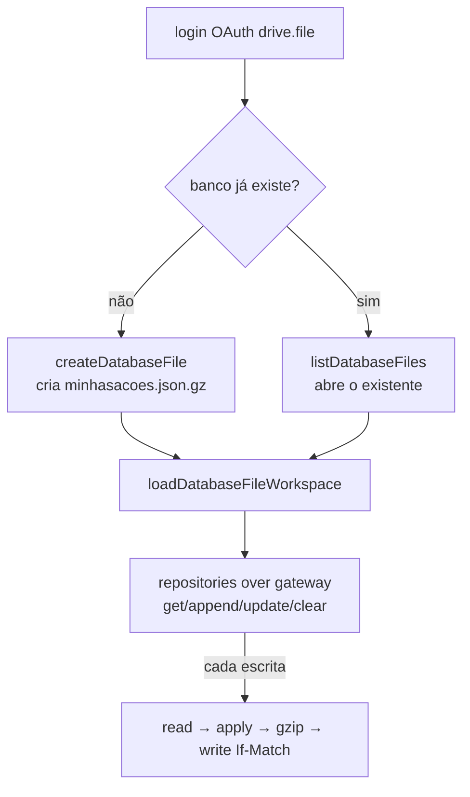

# Plano de implementação — Remover Google Sheets e usar banco JSON no Google Drive

> Status: **implementado** (fases 0–5 e 7 da seção 8; ver "Estado atual").
> Objetivo: substituir a planilha do Google Sheets por **um único arquivo JSON
> compactado (gzip) no Google Drive**, usando apenas o escopo **`drive.file`**
> (não sensível). Com isso o app **deixa de precisar de verificação OAuth e do
> vídeo de demonstração**, mantendo persistência na nuvem e sincronização entre
> dispositivos.

---

## 0. Estado atual e handoff para a próxima sessão

**Contexto (por que existe este plano):** o app usa o escopo sensível
`spreadsheets` (Google Sheets), que exige **verificação OAuth + vídeo de
demonstração** no Google Cloud. Decisão: remover o Sheets e persistir em um
**arquivo JSON compactado no Drive** com apenas `drive.file` (não sensível),
eliminando a verificação.

**Decisões já tomadas (não rediscutir sem motivo):**

- Manter os dois modos de armazenamento atuais (`google`/`local`); o modo
  `local` (IndexedDB + exportação `.ods`) permanece intacto.
- O backend `google` ganha um **flag de build** `VITE_GOOGLE_BACKEND=sheets|json`
  (padrão `sheets`) para coexistência durante o rollout.
- Preservar a superfície do gateway de células: repositórios/codecs/cache/
  outbox/sync **não mudam**.
- Formato do banco: JSON `{ version, sheets }` por aba (matriz `CellValue[][]`),
  compactado com gzip, com controle de concorrência por etag + `If-Match`.

**O que já existe (não reimplementar):**

- `gatewayRouter.ts` (roteia google/local), `sheets/localGateway.ts` +
  `localSheets.ts` (modo local), `sheetCodecs/sheetCells/sheetFormulas/a1`.
- `cache.ts` (IndexedDB), `outbox.ts`, `offlineRepositories.ts`,
  `application/sync.ts`.
- Compressão nativa: `DecompressionStream('deflate-raw')` já usada em
  `ods/zipReader.ts`; `ods/binary.ts` tem `toArrayBuffer`.
- `drive.ts` já tem `ensureAppFolder`/`moveFileToFolder` sob `drive.file`.

**Estado atual (implementado nesta rodada):**

- `compression.ts` (`gzip`/`gunzip`/`isGzip`, nativo com fallback) + testes.
- `driveFile/format.ts` (codec `{ version, sheets }` + normalização) + testes.
- `driveFile/api.ts` (criar/ler/escrever/listar, timeout, `If-Match`) + testes.
- `driveFile/gateway.ts` (mesma superfície do Sheets, cache por sessão, lote por
  `executarEmLote`, etag + 412 com releitura/reaplicação) + testes.
- Flag `VITE_GOOGLE_BACKEND` (`googleConfig.ts`, `vite-env.d.ts`,
  `.env.example`) e roteamento em `sheets/gatewayRouter.ts`.
- `sync.ts` executa o flush inteiro em `executarEmLote` e só limpa o outbox
  depois que o lote é gravado (`sheets`/`local` seguem como pass-through).
- `AuthProvider`/`authContext`/`WorkspaceSetup`/`DashboardPage`: fluxo
  `criarBanco`/`abrirBanco`/`abrirBancoPorId`, abertura por listagem no backend
  JSON, link do Drive e mensagens neutras. `diagnostics.ts` usa os contadores do
  backend ativo.
- Docs: `README.md`, `ARCHITECTURE.md` e `.env.example`.

**Pendências conhecidas:**

- Fase 6 (remoção de `sheets/gateway.ts` e do Picker) ficou **não aplicável**
  enquanto os dois backends coexistirem: o backend `sheets` continua sendo o
  padrão e depende de `sheets/gateway.ts`, `pickSpreadsheet` e
  `findSpreadsheetsByName`. Isso pode ser removido quando `json` virar padrão.
- Seção 6.2 (cotações sem `GOOGLEFINANCE`) continua como evolução futura.
- O `etag` depende do header `ETag` estar exposto por CORS; quando ausente, a
  escrita funciona sem `If-Match` (degrada a proteção contra concorrência).

---

## 1. Decisão central (o que torna o plano barato)

A arquitetura atual já separa o modelo de dados em camadas, e os repositórios
**não falam com o Sheets diretamente**: eles falam com um **gateway de células**
(`gatewayRouter.ts` → `sheets/gateway.ts`), que expõe operações de intervalo
A1 (`getValues`, `appendValues`, `updateValues`, `clearValues`, etc.).

Portanto, **não precisamos tocar em repositórios, codecs, cache, outbox nem
sincronização**. Basta trocar a implementação do gateway: em vez de chamar a
Sheets API, o gateway passa a:

1. Baixar o arquivo JSON do Drive;
2. Aplicar a operação de intervalo sobre uma estrutura em memória;
3. Compactar (gzip) e subir o arquivo de volta ao Drive.

O contrato (`Repository<T>`/`CrudRepository<T>`, `RepositoryContext`) e o
comportamento offline/PWA ficam **idênticos**.

### Formato do arquivo

O arquivo `minhasacoes.json.gz` contém, descompactado, exatamente o que o modo
local já guarda no IndexedDB por aba — uma matriz de células por aba:

```json
{
  "version": 1,
  "sheets": {
    "Operacoes": [["ID", "Data", "...", "..."], ["id1", "2026-01-01", "...", "..."]],
    "Proventos": [["ID", "Data Com", "..."]],
    "Consolidado": [["Ticker", "..."]],
    "Metas_Rebalanceamento": [["..."]],
    "Historico": [["..."]],
    "Valuation": [["..."]],
    "Configuracoes": [["..."]]
  }
}
```

`CellValue` (`string | number | boolean | null`) já é serializável em JSON e já
é o tipo usado por `sheetCells.ts`, pelo modo local e pela exportação `.ods`.

---

## 2. Requisitos (mapeamento)

| Requisito atual | Impacto |
| --- | --- |
| RF01 (modo de armazenamento) | Mantido: `'google'` passa a significar "arquivo JSON no Drive". |
| RF02 (modo local + interoperabilidade `.ods`) | Mantido integralmente (IndexedDB + exportar/importar `.ods`). |
| RF03 (escopos mínimos) | **Alterado**: `GOOGLE_SCOPES` vira `['https://www.googleapis.com/auth/drive.file']` (remove `spreadsheets`). |
| RF04/RF06 (leitura/escrita de dados) | Mantidos — mudam apenas o transportador (Drive em vez de Sheets). |
| RF07–RF17, RF18, RF23 (dashboard, rebalanceamento, histórico, B3) | **Inalterados** (rodam sobre repositórios agnósticos). |
| RNF02 (cache-first / poucas chamadas) | Mantido; otimização opcional de cache do arquivo decodificado por sessão. |
| RNF04 (erros amigáveis) | Adaptado: mensagens passam a citar "Drive" em vez de "Sheets". |
| RNF05 (token no navegador, renovação sob demanda) | Mantido; escopo passa a ser `drive.file`. |
| RNF08 (leitura offline) | Mantido (cache IndexedDB + outbox). |
| **Novo — RNF de concorrência** | Obrigatório: controle de versão com **etag + `If-Match`** (evitar perda de escrita em 2 dispositivos). |

---

## 3. Novos módulos

```
src/infrastructure/
├── compression.ts                 # gzip / gunzip (CompressionStream nativo + fallback)
└── driveFile/
    ├── format.ts                  # encode/decode do banco JSON (version + sheets)
    ├── api.ts                     # primitivas do Drive (criar/ler/escrever/listar o arquivo)
    └── gateway.ts                 # MESMA superfície de sheets/gateway.ts, sobre o JSON
```

### 3.1 `compression.ts`

- `gzip(bytes: Uint8Array): Promise<Uint8Array>`
- `gunzip(bytes: Uint8Array): Promise<Uint8Array>`
- Usa `CompressionStream('gzip')` / `DecompressionStream('gzip')`.
- Fallback: se a API não existir, devolve os bytes sem compactar (mesmo padrão
  de `typeof DecompressionStream === 'undefined'` já usado em `ods/zipReader.ts`).
- Reusa `toArrayBuffer` de `ods/binary.ts`.

### 3.2 `driveFile/format.ts` (puro, testável)

- `encodeDatabaseFile(sheets: Record<SheetName, CellValue[][]>, version = 1): Promise<Uint8Array>`
  → `TextEncoder` → `gzip`.
- `decodeDatabaseFile(bytes: Uint8Array): Promise<{ version: number; sheets: Record<SheetName, CellValue[][]> }>`
  → `gunzip` → `TextDecoder` → parse.
- Valida `version` e a presença das 7 abas; completa abas ausentes com o
  cabeçalho (migração idempotente, espelhando `ensureRequiredSheets`).

### 3.3 `driveFile/api.ts` (primitivas de rede)

Usa `https://www.googleapis.com/upload/drive/v3/files` e
`https://www.googleapis.com/drive/v3/files`, com `Authorization: Bearer`.

- `createDatabaseFile(token, name)` → `{ fileId }`
  (multipart `uploadType=media`, MIME `application/gzip`).
- `readDatabaseFile(token, fileId)` → `{ bytes, etag }`
  (`files/{id}?alt=media` + metadado `etag`).
- `writeDatabaseFile(token, fileId, bytes, etag?)` → `{ etag }`
  (`PATCH .../upload/drive/v3/files/{id}?uploadType=media` com `If-Match: etag`).
  - HTTP **412** = conflito: relê e reaplica (read-modify-write) ou informa.
- `listDatabaseFiles(token, name)` → `[{ fileId }]` (para "abrir banco existente").
- Reusa `ensureAppFolder`/`moveFileToFolder` de `drive.ts` para manter o arquivo
  na pasta `minhasacoe_app` (já coberto por `drive.file`).

### 3.4 `driveFile/gateway.ts` (a peça que substitui o Sheets)

Implementa a **mesma assinatura** de `sheets/gateway.ts`:

- `getValues`, `batchGetValues`, `updateValues`, `batchUpdateValues`,
  `appendValues`, `clearValues` → operações de intervalo A1 sobre o JSON
  decodificado (reusa `parseA1Range` de `sheets/a1.ts`).
- `getSpreadsheetLocale` → devolve `'pt_BR'` fixo.
- `createDefaultSpreadsheet(token, title)` → cria o arquivo JSON com as 7 abas
  vazias (só cabeçalho) e devolve o `SpreadsheetWorkspace` (file id = id do Drive).
- `loadSpreadsheetWorkspace(token, fileId)` → baixa o arquivo, garante abas/
  cabeçalhos em memória e devolve o workspace.
- `ensureSheetHeaders` / `ensureRequiredSheets` → versões em memória sobre o JSON
  (idempotentes), seguidas de upload se algo mudou.
- Reexporta erros/utilitários puros (`columnLetter`, `SheetsApiError`,
  `describeSheetsError`, contadores) para o `gatewayRouter` continuar funcionando.

> `sheetFormulas.ts` (fórmulas `GOOGLEFINANCE`) deixa de ser relevante: o
> `Consolidado` já é calculado 100% no cliente por `application/consolidado.ts`,
> então não há perda funcional.

---

## 4. Alterações nos arquivos existentes

| Arquivo | Mudança |
| --- | --- |
| `src/infrastructure/googleConfig.ts` | `GOOGLE_SCOPES = ['https://www.googleapis.com/auth/drive.file']`; remover comentários sobre Picker. |
| `src/infrastructure/sheets/gatewayRouter.ts` | Trocar o import `google` (Sheets) pelo novo `driveFile/gateway.ts`; manter o branch `local` e as funções de exportação. |
| `src/domain/workspace.ts` | Documentar que `spreadsheetId` agora é o **id do arquivo no Drive** (sem quebra de tipo). |
| `src/domain/armazenamento.ts` | Atualizar comentários: `'google'` = "arquivo JSON no Drive". |
| `src/presentation/app/providers/AuthProvider.tsx` | Renomear fluxos internos (`criarPlanilha` → `criarBanco`; `selecionarPlanilha` → `abrirBanco`); remover Picker; atualizar mensagens. |
| `src/presentation/features/dashboard/DashboardPage.tsx` | Trocar o link `docs.google.com/spreadsheets/d/...` por `drive.google.com/file/d/...` (ou remover). |
| `src/infrastructure/drive.ts` | Manter `ensureAppFolder`/`moveFileToFolder`; **remover** `pickSpreadsheet`/`findSpreadsheetsByName` (Picker). |
| `src/infrastructure/googleConfig.ts` + `.env.example` + README | Remover `VITE_GOOGLE_PICKER_API_KEY`/`PROJECT_NUMBER`; manter `VITE_GOOGLE_CLIENT_ID`. |
| `src/infrastructure/sheets/gateway.ts` | Mantido: é o adaptador do backend `sheets` (padrão). Só apagar quando `json` virar padrão. |

---

## 4.1 Chaveamento de backend no `.env` (coexistência Sheets ↔ JSON)

Um flag de **build** decide o backend do modo `google` e os escopos pedidos:

```ts
// googleConfig.ts
export type GoogleBackend = 'sheets' | 'json'

export const GOOGLE_BACKEND: GoogleBackend =
  import.meta.env.VITE_GOOGLE_BACKEND === 'json' ? 'json' : 'sheets'

export const GOOGLE_SCOPES = GOOGLE_BACKEND === 'json'
  ? ['https://www.googleapis.com/auth/drive.file']
  : [
      'https://www.googleapis.com/auth/spreadsheets',
      'https://www.googleapis.com/auth/drive.file',
    ]

export function isJsonBackend(): boolean {
  return GOOGLE_BACKEND === 'json'
}
```

- `VITE_*` é substituído em **tempo de build** — o flag é de build, não de
  runtime. Produção compila com `sheets`; teste/estágio com `json`.
- `gatewayRouter.ts` seleciona o adaptador pelo flag:
  `const google = isJsonBackend() ? driveFileGateway : sheetsGateway`.
- `AuthProvider.tsx`/`DashboardPage.tsx` ramificam criação/abertura de workspace
  e o link do arquivo pelo mesmo flag.

| Backend | Escopos | Criar | Abrir existente | Link |
| --- | --- | --- | --- | --- |
| `sheets` | `spreadsheets` + `drive.file` | `createDefaultSpreadsheet` | Picker | `docs.google.com/spreadsheets/d/…` |
| `json` | `drive.file` | `createDatabaseFile` | `listDatabaseFiles` | `drive.google.com/file/d/…` |

Adicionar ao `.env.example`:

```
# Backend do modo Google: 'sheets' (padrão) ou 'json' (arquivo no Drive).
VITE_GOOGLE_BACKEND=sheets
```

## 5. Fluxo de login/workspace (novo)



---

## 6. Concorrência e consistência

- Toda escrita usa **read-modify-write** com `If-Match` no `etag`.
- Em **HTTP 412** (alguém alterou entre a leitura e a escrita): relê o arquivo e
  reaplica a mutação **uma vez**; se ainda conflitar, mantém a mutação no outbox
  e sinaliza (não sobrescreve cegamente).
- Primeira versão: o merge fino por registro fica como evolução futura (o outbox
  já guarda mutações por entidade, o que habilita esse merge depois).

---

## 6.1 Comportamento offline e rede lenta (requisitos do gateway)

**O que já funciona e NÃO muda:**

- Leitura cache-first (`cache.ts` + `repositories.ts`) — offline lê do IndexedDB.
- Escrita otimista + outbox (`offlineRepositories.ts`) quando
  `navigator.onLine === false`.
- Sync FIFO (`application/sync.ts`) disparado em `online`/mount/retry a cada 60s
  (`useSync`).

**Requisitos novos, específicos do gateway Drive (`driveFile/api.ts`):**

1. **Erros compatíveis com `isOfflineWriteError`** (`offlineRepositories.ts`,
   que aceita `status === 0` ou `429`):
   - falha de rede → `status 0`;
   - HTTP 429 → `status 429`;
   - HTTP 401/403 → `status 401/403`.
   Reusar `SheetsApiError`/`GoogleDriveError` (ambos carregam `status`) para o
   fallback automático para outbox continuar funcionando **sem alterações**.
2. **Timeout obrigatório** (`AbortController`): download/upload que demorar além
   de N ms é abortado e convertido em `status 0` → a escrita cai no outbox.
   Evita que uma rede lenta "pendurada" trave a operação indefinidamente.
3. **Flush em lote no sync**: ao reconectar, `sync.ts` aplica **todas** as
   mutações pendentes num único read-modify-write (1 download + 1 upload), em
   vez de uma ida-e-volta por mutação. Nesse cenário o JSON é **mais eficiente**
   que o Sheets (que faria N chamadas).
4. **Expor `isQuotaError`/`describeSheetsError`** (ou equivalentes) para o
   `sync.ts` e o `AuthProvider` manterem retry e renovação de token em 401.

**Comportamento esperado:**

| Situação | Leitura | Escrita |
| --- | --- | --- |
| Offline | cache (IndexedDB) | otimista no cache + outbox |
| Reconectou | cache até `forceRefresh` | flush em lote (1 read + 1 write p/ toda a fila) |
| Drive lento (online) | cache, sem bloquear a UI | otimista; upload em segundo plano; timeout → outbox |
| 2 dispositivos offline | — | etag + `If-Match`; HTTP 412 → relê e reaplica |

---

## 6.2 Cotações pós-Sheets (substituição do GOOGLEFINANCE)

**Fato:** `GOOGLEFINANCE` só existe como fórmula do Google Sheets — não há API
pública fora da planilha. Removendo o Sheets, ele sai junto. Para ativos B3
(ação, FII, BDR, ETF), a fonte passa a ser **100% Brapi**; Tesouro/Renda Fixa
continuam com marcação manual/estimada.

**Mudanças no código (futuro):**

- `sheetFormulas.ts` (fórmulas `GOOGLEFINANCE`, `priceopen`, separador) vira
  código morto → remover.
- `domain/cotacoes.ts`: a ordem `GOOGLEFINANCE → Brapi → preço médio` vira
  `Brapi → preço médio` (o branch `precoMercado` deixa de ser alimentado).
- `application/dashboard.ts`: a cotação deixa de vir da aba `Consolidado`
  (fórmulas) e passa a vir integralmente de `buscarCotacoesBrapi`.

**Tratamento das lacunas (plano gratuito da Brapi):**

| Lacuna | Tratamento |
| --- | --- |
| 1 requisição por ticker (plano grátis) | Aumentar `CACHE_TTL_MS` em `brapi.ts` de 15 min para **2 horas**; busca **só dos tickers fora do cache** (já existe); manter execução **sequencial** (sem rajada) para não estourar cota. |
| Preço de abertura / variação do dia | Estender `extrairCotacoes` para extrair `regularMarketOpen` → `precoAbertura` (mesma resposta, sem chamada extra) e ligar esse campo no `dashboard.ts` (`precoAberturaBrapi` → `resolverCotacao`) para a coluna "Variação Dia (%)" voltar a preencher. |
| Token obrigatório | Sem `VITE_BRAPI_TOKEN` o fallback continua desligado (comportamento atual, preservado). |

**Passo pendente (futuro):** criar um mapa `precoAbertura` a partir de
`buscarCotacoesBrapi`/`lerCotacaoCache` e passá-lo a `resolverCotacao`, para que
o status `brapi` preencha `precoAbertura` e `variacaoDiaPercent` (hoje `null`).

---

## 7. Riscos e trade-offs

| Risco | Mitigação |
| --- | --- |
| Conflito de escrita (2 dispositivos) | etag + `If-Match`; retry em 412; documentar limitação. |
| Cada escrita baixa/sobe o arquivo inteiro | Gzip (70–90% menor); cache do JSON decodificado por sessão; snapshot+log como evolução. |
| Arquivo opaco no Drive (sem edição em Sheets) | Aceito por decisão de produto; `.ods` segue como exportação/importação. |
| Migração de usuários com planilha existente | Usar a exportação `.ods` atual como caminho de migração; ou, temporariamente, manter leitura via Sheets só para importar. |
| Quota do Drive API | Para carteira típica (<2 MB) é irrelevante; acompanhar em diagnóstico. |

---

## 8. Sequência de implementação (incremental e testável)

1. **Fase 0** — `compression.ts` + testes (round-trip e fallback).
2. **Fase 0.5** — esqueleto do flag `VITE_GOOGLE_BACKEND` (seção 4.1), padrão `sheets`.
3. **Fase 1** — `driveFile/format.ts` + testes (encode/decode, validação de versão, abas faltantes).
4. **Fase 2** — `driveFile/api.ts` (criar/ler/escrever/listar) com `fetch` mockável + teste de 412.
5. **Fase 3** — `driveFile/gateway.ts` (operações A1 sobre JSON) + testes de intervalo.
6. **Fase 4** — apontar `gatewayRouter.ts` para o novo gateway via `isJsonBackend()`.
7. **Fase 5** — `AuthProvider.tsx`/`DashboardPage.tsx`/mensagens e remoção do Picker.
8. **Fase 6** — limpeza de `sheets/gateway.ts`, `.env.example`, README.
9. **Fase 7** — revisão do `diagnostics.ts` para refletir o novo transportador.

**Critério de aceite:** com `VITE_GOOGLE_CLIENT_ID` de um projeto de teste (só
com `drive.file`), criar carteira, lançar operação, recarregar, abrir em outro
navegador e ver os dados sincronizados — **sem** tela de app não verificado e
**sem** escopo sensível no consentimento.
