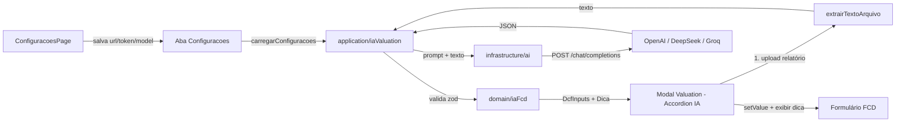

# Plano de Implementação — Análise de FCD com IA

> Status: **proposta** (nada implementado ainda)
> Escopo de provedores: **OpenAI**, **DeepSeek** e **Groq** (Anthropic fora do escopo).
> Objetivo: cadastrar URL + token de uma API de IA, enviar um relatório (PDF/DOCX/TXT) e fazer a IA extrair as premissas do FCD, preencher os campos da aba Valuation e dar uma dica com pontos bons/ruins do ticker.

---

## 1. Contexto e pontos de extensão existentes

O projeto já tem os "ganchos" necessários — a feature reusa padrões consolidados:

| Necessidade | Onde já existe o padrão |
|---|---|
| Persistir credenciais do usuário | Aba `Configuracoes` (chave/valor) — hoje com `brapi_token` |
| Tipos/regras de configuração | `src/domain/configuracoes.ts` |
| Ler/salvar configurações | `src/application/configuracoes.ts` |
| UI de configurações | `src/presentation/features/configuracoes/ConfiguracoesPage.tsx` |
| Cliente HTTP com `fetch` + timeout (`AbortController`) | `src/infrastructure/brapi.ts` |
| Cálculo FCD puro | `src/domain/dcf.ts` (`calcularFluxoDescontado`) |
| Validação `zod` das premissas | `src/presentation/features/dashboard/valuationSchema.ts` (`dcfFormSchema`) |
| Formulário da aba Valuation | `src/presentation/features/dashboard/DetalheAtivoValuation.tsx` |
| Conversões monetárias (reais ↔ centavos) | `src/domain/money.ts` |

**Decisões de projeto:**

1. **Um único cliente "OpenAI-compatible"** — os três provedores expõem o mesmo formato `POST /chat/completions` com header `Authorization: Bearer <token>`. O usuário cadastra a URL; o app só troca a URL default e o `model`.
   - OpenAI: `https://api.openai.com/v1/chat/completions`
   - DeepSeek: `https://api.deepseek.com/chat/completions`
   - Groq: `https://api.groq.com/openai/v1/chat/completions`
2. **Extração de texto no navegador** (não envio de arquivo/binário): uniforme entre os 3 provedores e mais barata em tokens. PDF via `pdfjs-dist`; DOCX via `mammoth`; TXT lido direto.
3. **Token na planilha** (`Configuracoes`), igual ao `brapiToken` — mesmo trade-off de segurança atual (texto puro na planilha/IndexedDB). Aviso na UI.
4. **A IA nunca grava sozinha**: ela preenche os campos; o usuário revisa e clica em "Calcular preço justo" / "Salvar análise". A dica é exibida e pode ser anexada a `anotacoes`.

---

## 2. Arquitetura alvo



---

## 3. Fases de implementação

### Fase 1 — Configuração da API de IA

**Arquivos:**
- `src/domain/configuracoes.ts` (editar)
- `src/presentation/features/configuracoes/ConfiguracoesPage.tsx` (editar)

**O que fazer:**
1. Estender `CONFIG_CHAVES`:
   ```ts
   export const CONFIG_CHAVES = {
     brapiToken: 'brapi_token',
     aiApiUrl: 'ai_api_url',
     aiApiToken: 'ai_api_token',
     aiModel: 'ai_model',
   } as const
   ```
2. Estender `IntegracoesConfig` com `aiApiUrl`, `aiApiToken`, `aiModel` (strings vazias no `INTEGRACOES_CONFIG_VAZIA`).
3. Atualizar `configDeRegistros` e `registrosDeConfig`.
4. Na `ConfiguracoesPage`: seção **"Inteligência Artificial (FCD)"** com:
   - `select` de provedor (OpenAI / DeepSeek / Groq / Personalizado) que preenche a URL default;
   - campo URL (editável), campo Token (com toggle mostrar/ocultar), campo Modelo;
   - ao salvar, chamar `clearAiCache()` (se houver cache de resposta) e mostrar aviso de que o token fica na planilha.

> `salvarConfiguracoes` já preserva chaves desconhecidas — planilhas antigas continuam funcionando.

---

### Fase 2 — Cliente HTTP da IA (`infrastructure/ai.ts`)

**Arquivo novo:** `src/infrastructure/ai.ts` (inspirado em `src/infrastructure/brapi.ts`).

**Contrato:**
```ts
export interface AiChatRequest {
  url: string
  token: string
  model: string
  messages: { role: 'system' | 'user'; content: string }[]
}

export interface AiChatResponse {
  content: string // texto da 1ª escolha
}

export async function chamarChatCompletions(req: AiChatRequest): Promise<AiChatResponse>
```

**Regras:**
- `fetch(req.url, { method: 'POST', headers: { Authorization: `Bearer ${req.token}`, 'Content-Type': 'application/json' }, body: JSON.stringify({ model, messages, temperature: 0.2, response_format: { type: 'json_object' } }) })`.
- Timeout via `AbortController` (ex.: 30 s, maior que o Brapi pois geração é lenta).
- **Nunca lançar** — retorna `null`/erro tipado em falha de rede/quota/formato (mesma filosofia best-effort do Brapi).
- Tratar CORS: os 3 provedores permitem chamada direta do navegador; documentar no help da UI.
- `response_format: json_object` (suportado pelos 3) para forçar JSON; fallback: remover cercas de markdown `` ```json ... ``` `` ao parsear.

---

### Fase 3 — Extração estruturada (`domain/iaFcd.ts`)

**Arquivo novo:** `src/domain/iaFcd.ts` — módulo **puro e testável** (sem rede).

**Responsabilidades:**
1. `montarPromptIa(ticker: string, relatorio: string): string` — instruções em pt-BR pedindo JSON com premissas + dica.
2. `parsearRespostaIa(texto: string): IaFcdResultado | null` — remove code fences, `JSON.parse`, valida com `zod`.
3. `paraDcfInputs(resultado): DcfInputs` — converte reais → centavos (via `toCentavos`) e monta os inputs do `calcularFluxoDescontado`.

**Schema `zod` da resposta:**
```ts
export const iaFcdRespostaSchema = z.object({
  premissas: z.object({
    fclAtual: z.coerce.number(),            // reais, > 0
    dividaLiquida: z.coerce.number(),       // pode ser negativa
    acoesMilhoes: z.coerce.number().positive(),
    crescimentoAno: z.coerce.number(),      // % a.a.
    taxaDesconto: z.coerce.number().positive(),
    anosProjecao: z.coerce.number().int().min(1).max(50),
    crescimentoPerpetuidade: z.coerce.number(), // deve ser < taxaDesconto
  }),
  dica: z.object({
    pontosPositivos: z.array(z.string()).max(5),
    pontosNegativos: z.array(z.string()).max(5),
    resumo: z.string().max(1000),
  }),
  fonte: z.string().max(500).optional(),
})
```

> Validações de consistência (ex.: `taxaDesconto > crescimentoPerpetuidade`) ficam no `calcularFluxoDescontado` já existente; a IA também é instruída a respeitar isso, mas o app sempre revalida.

**Prompt (rascunho):**
> "Você é um analista financeiro. A partir do relatório abaixo do ticker {ticker}, extraia as premissas para o Fluxo de Caixa Descontado (FCD) e faça uma análise curta. Responda APENAS um JSON válido no formato {...}. Se um dado não estiver no relatório, estime com base em dados de mercado e indique 'fonte'='estimativa'."

**Testes (`src/domain/iaFcd.test.ts`):** prompt contém ticker/trechos; parse aceita JSON com e sem code fences; parse rejeita JSON inválido; conversão reais → centavos correta.

---

### Fase 4 — Leitura do relatório (`presentation/features/dashboard/extrairTextoArquivo.ts`)

**Arquivo novo:** `src/presentation/features/dashboard/extrairTextoArquivo.ts` (ou pasta `infrastructure/`).

```ts
export async function extrairTextoDeArquivo(file: File): Promise<string>
```

- **PDF** → `pdfjs-dist` (`getDocument`, percorrer páginas, `getTextContent`).
- **DOCX** → `mammoth` (`extractRawText`).
- **TXT/MD** → `file.text()`.
- Limite de tamanho (ex.: ~2 MB / ~50 mil caracteres) para não estourar a janela de contexto — recorta e avisa.
- Erros retornam mensagem amigável ("formato não suportado").

**Dependências novas:** `pdfjs-dist`, `mammoth` (avaliar bundle com lazy import, como os gráficos Recharts já fazem via `React.lazy`).

---

### Fase 5 — Orquestração (`application/iaValuation.ts`)

**Arquivo novo:** `src/application/iaValuation.ts`.

```ts
export interface ExtrairFcdResultado {
  premissas: DcfInputs | null
  dica: IaDica | null
}

export async function extrairFcdComIa(
  context: RepositoryContext,
  ticker: string,
  textoRelatorio: string,
): Promise<ExtrairFcdResultado>
```

**Fluxo:**
1. `carregarConfiguracoes(context)` → valida `aiApiUrl`, `aiApiToken`, `aiModel` (senão erro "configure em Ajustes").
2. `montarPromptIa(ticker, textoRelatorio)`.
3. `chamarChatCompletions(...)`.
4. `parsearRespostaIa(content)`.
5. Retorna `premissas` + `dica` (ou erro tipado para a UI).

---

### Fase 6 — UI no modal Valuation (`DetalheAtivoValuation.tsx`)

Dentro do `Accordion` **"Fluxo de Caixa Descontado (FCD)"**, adicionar um segundo `Accordion` (ou bloco) **"Análise com IA"**:

1. **Input de arquivo** (PDF/DOCX/TXT) + prévia do texto extraído (colapsável).
2. Botão **"Extrair premissas com IA"**:
   - estados: carregando (spinner), erro, sucesso;
   - chama `extrairFcdComIa`;
   - em sucesso, preenche os campos via `setValue`:
     - `fclAtual`, `dividaLiquida` → `formatMoneyInput(centavos)`;
     - `acoesMilhoes`, `crescimentoAno`, `taxaDesconto`, `anosProjecao`, `crescimentoPerpetuidade` → `String(v).replace('.', ',')`.
   - o usuário revisa e clica em "Calcular preço justo" (fluxo atual).
3. **Painel da dica**: pontos positivos ✅ / negativos ⚠️ + resumo + `fonte`; botão "Anexar dica às anotações" (`setValue('anotacoes', ...)`).
4. Warnings de segurança: "O relatório é enviado para a API configurada."

> Não usar o estado global; manter tudo local no componente, como o FCD já faz.

---

### Fase 7 — Testes, build e revisão

- **Testes unitários** (puros, sem rede): `domain/iaFcd.test.ts`; ajustar `domain/configuracoes.test.ts` (se existir) para as novas chaves.
- **Typecheck/lint/testes**: `npm run typecheck`, `npm run lint`, `npm test -- --run` (Node 20).
- **Validação manual**: configurar cada provedor, upload de um release PDF real, conferir valores extraídos vs. preenchidos e a dica.

---

## 4. Critérios de aceite

- [ ] Usuário cadastra URL, token e modelo na página de Configurações; valores persistem na aba `Configuracoes`.
- [ ] Provedores OpenAI, DeepSeek e Groq funcionam com o mesmo fluxo (URL default + token + model).
- [ ] Upload de relatório PDF/DOCX/TXT extrai o texto no navegador.
- [ ] Botão "Extrair premissas com IA" preenche os 7 campos do FCD; valores inválidos são bloqueados pela validação.
- [ ] Botão "Calcular preço justo" continua preenchendo o Preço Teto a partir das premissas.
- [ ] Dica exibida com pontos positivos/negativos; opção de anexar às anotações.
- [ ] Falhas de rede/quota/formato não travam a UI (best-effort, mensagens claras).
- [ ] Token não aparece em log; aviso de armazenamento em texto puro na UI.

---

## 5. Riscos e observações

| Risco | Mitigação |
|---|---|
| CORS (algum endpoint bloqueia chamada do navegador) | Testar os 3 provedores; se necessário, tratar erro e orientar o usuário. |
| Token em texto puro na planilha | Mesmo padrão do `brapiToken`; aviso explícito na UI. |
| IA alucina números | `zod` + revalidação do `calcularFluxoDescontado`; usuário sempre revisa antes de salvar. |
| Relatórios grandes estouram contexto | Limite de caracteres com recorte e aviso. |
| Custo/limites de requisição | Timeout, `temperature` baixa, um único POST por extração. |
